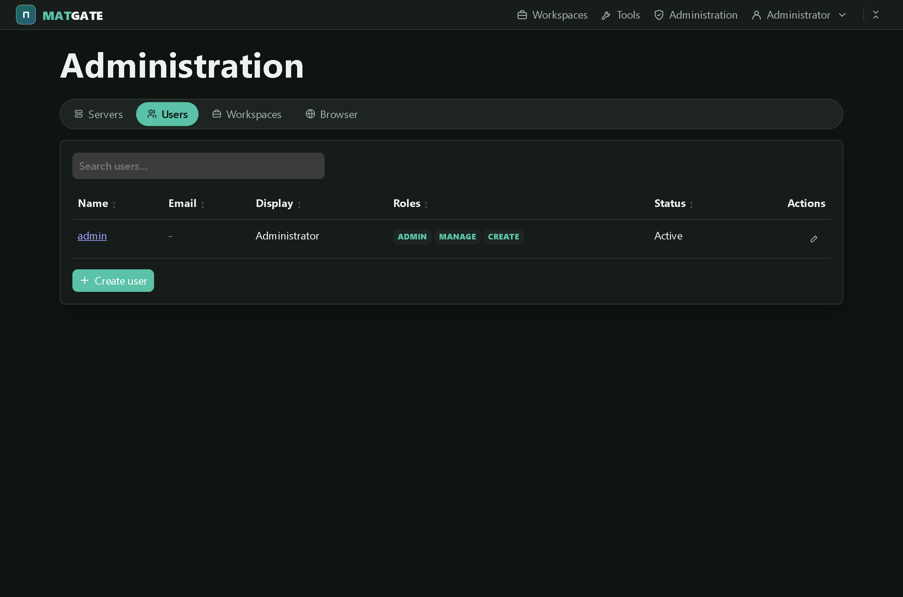
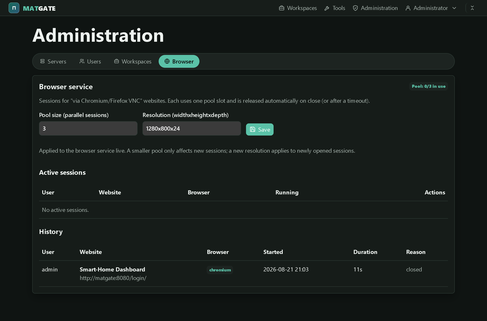
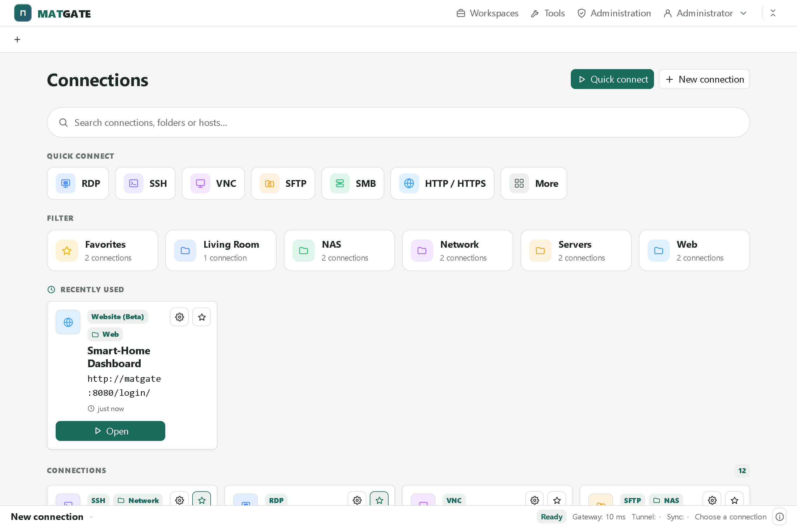

<div align="center">


# Matgate

**One login for your whole home network – in the browser.**

Remote desktops (RDP/VNC), shell (SSH), file access (SFTP/FTP/SMB) and internal web UIs,
behind a single self-hosted gateway. One Docker stack, no cloud, no agents on your machines.

</div>


---

## What this is about

Your home network is full of things you occasionally need to reach: a Windows box over RDP,
a Linux server over SSH, the NAS share, the router's web UI. Normally that means an RDP client
here, an SSH client there, a VPN, a bookmark, a password sheet. Matgate puts all of it behind
**one web UI and one login**: every machine as a tile, every session as a tab, every credential
stored **encrypted** in one place. RDP and VNC run through Matgate's own display engine (FreeRDP and
LibVNC, shown as H.264 by the browser itself), SSH in Matgate itself; Apache Guacamole is there as a
second way to open them, chosen per connection - or left out altogether. Files, the website proxy,
users, permissions and the UI are Matgate's own.

It is built to sit on a home server in Docker, optionally behind a reverse proxy, and to be
usable from a laptop or a phone – installable as a PWA.

## At a glance

**Remote sessions**
- **RDP, VNC and SSH** in the browser, no client install - through **Matgate's own engine** or through
  **Guacamole**, picked per connection ("Open as"), see [Two engines](#two-engines-for-remote-sessions)
- RDP with a **clipboard for text, pictures and files** in both directions (Ctrl+V puts files into the
  Explorer window that is open), **sound**, and a resolution that **follows the window without reconnecting**
- A password that is not stored is **asked for when connecting**
- Several sessions open at once as **draggable tabs**, with session restore
- **Pop a session out into its own window** and re-attach it later (great for multi-monitor)
- **Real fullscreen / immersive mode** (safe-area aware on iPhone), clipboard sync, a live status bar
- Per-session **scale** for VNC through Guacamole (Auto / 75% / 50%) so more fits on screen

**Files**
- File gateway for **SFTP, FTP and SMB** – no extra privileges in the container
- Upload, download, **zip / unzip**, copy, move, delete, archive extraction
- **Preview** for images, video, audio, PDF and text

**Websites**
- **Native reverse-proxy** mode for internal admin UIs (router, NAS, …)
- **"via Chromium / Firefox VNC"** fallback: the page opens in a real browser on an optional
  **browser farm** and is streamed over VNC – for pages the plain proxy can't render. Kiosk by
  default, auto-sized to your window, with smart-reconnect on resize

**Organizing & sharing**
- **Quick connect** for ad-hoc sessions without saving anything
- **Folders**, per-user **favorites**, search across names, folders and hosts
- **Workspaces**: shareable bundles with public links, password protection, shared text and file exchange
- Live **network tools**: ping, DNS lookup, port check, streamed download test

**Users & operation**
- Local users with **username + email + password**, a **first-run setup wizard**
- Admin roles and **per-server access control**; global servers and user-owned servers
- Credentials **encrypted at rest**; `/guacamole` sits behind the Matgate login
- **English and German**, light / dark (follows the system), installable **PWA**

## Screenshots

### First run, then one login

| Setup wizard | Sign in |
|---|---|
|  |  |

On the very first start a **setup wizard** creates your administrator account; after that it is a
single sign-in. From there every machine is a tile, grouped into folders with favorites on top and
a search across names and hosts.

### Ad-hoc without saving anything


**Quick connect** starts a one-off RDP/VNC/SSH/website session without creating a saved server.

### A live session


Every connection opens as a tab with its own toolbar (fullscreen, clipboard, scale, disconnect)
and a status bar showing tunnel state and latency. Shown here: a website opened in a real browser
through the **browser farm** – the fallback for web UIs the native proxy can't display.

### Administration in one place

| Servers | Users |
|---|---|
|  |  |

Servers as a **gallery or a list**, each with its protocol, folder and scope. The server editor
covers every connection type; websites additionally pick their render mode.


### The optional browser farm



A pool of isolated Chromium/Firefox sessions (each on its own VNC port) powers the
"via … VNC" websites. Pool size and resolution are live-configurable, with active sessions and
a history right in the admin area. It's an **optional** sidecar – without it, only "Native"
websites are offered.

### Light theme and phones

| Light | Phone |
|---|---|
|  |  |

## Quick start

Prebuilt images are published to the GitHub Container Registry:

| Image | Tag | Use it for |
|---|---|---|
| `ghcr.io/real-ttx/matgate` | `latest` | the current release |
| `ghcr.io/real-ttx/matgate` | `0.9.60`, `sha-…` | pinning an exact build |
| `ghcr.io/real-ttx/matgate-display` | `latest` | Matgate's display engine (RDP and VNC) |
| `ghcr.io/real-ttx/matgate-browser-farm` | `latest` | the optional browser farm |

Remote sessions have two engines: **Matgate's own** (one small container, the display engine, for RDP
and VNC - SSH needs nothing extra) and **Apache Guacamole** (two containers). A stack can run either or
both; with both, every connection picks one. A small edge proxy is the single entrance, compresses what
Matgate sends and keeps `/guacamole` behind the login. Three ready-made stacks live in this repo —
grab one and run it, no build required:

| File | What you get |
|---|---|
| [`docker-compose.simple.yml`](docker-compose.simple.yml) | RDP, VNC and SSH through Matgate's own engine, files and **native** websites — **without Guacamole**, nothing to configure |
| [`docker-compose.yml`](docker-compose.yml) | **both engines** (a choice per connection), plus the options most installs want: own admin, HTTPS, home DNS, pinned keys |
| [`docker-compose.full.yml`](docker-compose.full.yml) | all of that **plus the browser farm** ("via Chromium / Firefox VNC" websites) |

```bash
docker compose -f docker-compose.simple.yml up -d    # minimal, without Guacamole
docker compose up -d                                 # both engines, with the usual options
docker compose -f docker-compose.full.yml up -d      # everything, browser farm included
```

Open **http://localhost:8088** — the first start shows a **setup wizard** that creates your
administrator account (username, email, password). All three files are self-contained and use the prebuilt
images. **Matgate generates and persists its own keys** (the at-rest key and the ones it shares with its
display engine and with Guacamole) into the `matgate-secrets` volume — nothing to configure by hand. For
reference, the whole `docker-compose.simple.yml`:

```yaml
# Matgate, minimal - without Guacamole: RDP, VNC and SSH through Matgate's own engine, file connections,
# native websites. Three small containers.
#
#   docker compose -f docker-compose.simple.yml up -d
#
# Open http://localhost:8088 - the first start asks you to create the admin account. Nothing to
# configure: Matgate generates its own keys and shares the one for its display engine with it.
#
# Want Guacamole as well (a choice per connection) and the usual options?  ->  docker-compose.yml
# Want the browser farm on top?                                           ->  docker-compose.full.yml
#
# Coming from an older copy of this file, which ran Guacamole? Add --remove-orphans once, so its two
# containers go.
name: matgate

services:
  # The single entrance on 8088; it also compresses what Matgate sends.
  edge:
    image: caddy:2
    depends_on: [matgate]
    ports:
      - "8088:8088"
    entrypoint:
      - /bin/sh
      - -c
      - |
        printf "%s\n" \
          ":8088 {" \
          "  encode zstd gzip" \
          "  reverse_proxy matgate:8080" \
          "}" > /tmp/Caddyfile && exec caddy run --config /tmp/Caddyfile --adapter caddyfile
    restart: unless-stopped

  matgate:
    image: ghcr.io/real-ttx/matgate:latest
    environment:
      # RDP and VNC go through the display engine below; SSH runs in Matgate itself.
      MATGATE_DISPLAY_ADDRESS: display:8092
      # This stack has no Guacamole: every connection opens with Matgate's own engine.
      MATGATE_GUACAMOLE: "off"
    volumes:
      - ./data:/data
      - matgate-files:/files
      - matgate-secrets:/run/matgate-secrets
    extra_hosts:
      - "host.docker.internal:host-gateway"
    restart: unless-stopped

  # Matgate's display engine: connects to RDP servers (FreeRDP) and VNC servers (LibVNC) and sends the
  # picture to the browser as H.264. It has no port to the outside - only Matgate talks to it, with a key
  # both read from the secrets volume.
  display:
    image: ghcr.io/real-ttx/matgate-display:latest
    volumes:
      # The same tree as Matgate, at the same path: an RDP session's drive is one folder in here, and the
      # links inside it have to resolve to the same place in both containers.
      - matgate-files:/files
      - matgate-secrets:/run/matgate-secrets:ro
    extra_hosts:
      - "host.docker.internal:host-gateway"
    restart: unless-stopped

volumes:
  # The encryption keys. Back this up - without it, stored device passwords cannot be decrypted.
  matgate-secrets:
  # Files exchanged with sessions. Point it at a path of your own to keep them elsewhere.
  matgate-files:
```

After the first admin is created you add your first server and connect.

> `docker-compose.yml` can also build Matgate and its display engine from this repository instead of
> pulling the published images — that is what `docker compose up --build -d` does. Ignore it unless you
> work on Matgate.

### Two engines for remote sessions

Every RDP, VNC and SSH connection has an **Open as** setting - its sub type, as a website has its render
mode:

| | **Matgate** (own engine) | **Guacamole** |
|---|---|---|
| RDP | FreeRDP 3 in the display engine, the picture as H.264 decoded by the browser (WebCodecs) | guacd and the Guacamole client |
| RDP clipboard | text, pictures and **files**, both ways: Ctrl+V puts files where the remote desktop has its focus, files copied there are offered for download | text; files through the session's drive |
| RDP window size | the session follows the window without reconnecting (Display Control) | reconnects at the new size |
| RDP sound, drive | sound as Opus; the drive `Files` with the file areas | the drive `Files` with the file areas |
| VNC | LibVNC in the display engine; text clipboard; the desktop is resized to the window where the server can | guacd; per-session scale |
| SSH | in Matgate itself (SSH.NET, xterm.js); asks for a missing user or password in the terminal; files pasted or dropped go to the home folder by SFTP | Guacamole's terminal; files through its SFTP dialog |
| Needs | the `display` container for RDP and VNC | the `guacd` and `guacamole` containers |

What a connection asks for is what opens it. Only when that engine is not part of the installation
does the other one step in - a stack without Guacamole opens everything with Matgate's own, a stack
without the display engine opens RDP and VNC with Guacamole - and the connection form says so.
"Via Chromium / Firefox VNC" websites are shown by Guacamole, so they need it (and the browser farm).
Matgate's own engine needs a browser with WebCodecs: a current Edge, Chrome, Firefox or Safari.

### Pin your keys (recommended)

Matgate generates its secrets on first start into the `matgate-secrets` volume:

- `master.key` – encrypts stored device passwords **at rest**
- `guac.key` – signs the Guacamole session tokens (**must match** between `matgate` and `guacamole`)
- `display.key` – what Matgate shows its display engine, so that nothing else can ask it for a screen
  (both read it from the volume; a new one is as good as the old, nothing to pin)

If that volume is ever lost or recreated, new keys are generated and the **stored passwords can no
longer be decrypted**. To make the keys survive any redeploy, pin the current values into a `.env`
next to the compose file – once, non-destructively:

```bash
docker exec matgate-matgate-1 sh -c \
  'printf "MATGATE_GUACAMOLE_JSON_SECRET_KEY=%s\nMATGATE_SECRET_KEY=%s\n" \
   "$(cat /run/matgate-secrets/guac.key)" "$(cat /run/matgate-secrets/master.key)"' >> .env

docker compose up -d
```

From then on the keys come from `.env` and never regenerate. `MATGATE_GUACAMOLE_JSON_SECRET_KEY`
is 32 hex characters, `MATGATE_SECRET_KEY` is 64.

## Configuration

| Variable | Default | Meaning |
|---|---|---|
| `MATGATE_DATA_DIR` | `/data` | Persistent data directory inside the container |
| `MATGATE_ADMIN_USER` / `MATGATE_ADMIN_PASSWORD` / `MATGATE_ADMIN_EMAIL` | – | Seed the admin unattended and skip the setup wizard |
| `MATGATE_DISPLAY_ADDRESS` | – | `host:port` of the display engine, e.g. `display:8092`. Without it, RDP and VNC open with Guacamole |
| `MATGATE_GUACAMOLE` | on | `off` for a stack without Guacamole: every connection opens with Matgate's own engine |
| `MATGATE_GUACAMOLE_JSON_SECRET_KEY` | auto | 32 hex chars for Guacamole JSON auth (see *Pin your keys*) |
| `MATGATE_SECRET_KEY` | auto | 64 hex chars for at-rest encryption of credentials |
| `MATGATE_REQUIRE_HTTPS` | `false` | Force HTTPS / secure cookies behind a TLS proxy |
| `MATGATE_DNS_SERVER` / `MATGATE_DNS_SEARCH` | – | Point the containers at your home DNS so `nas`, `pc-terminal`, … resolve |
| `BrowserFarm__BaseUrl` | `http://browser-farm:8090` | Where the optional browser farm lives |

## Data & persistence

Everything lives under the data directory (`./data` in the examples, mounted at `/data`):

```
/data
├─ users.json               local users, permissions, favorites
├─ servers.json             global + user-owned servers and folders
├─ workspaces.json          workspace definitions and share settings
├─ guacamole.properties     generated Guacamole config
└─ user-mapping.xml         generated Guacamole mapping (no cleartext credentials)
```

Files people exchange with their sessions do **not** live here - they have their own tree, see below.

## File areas

Files exchanged with a session live in their own volume (`matgate-files`), apart from the gateway state:

```
/files
├─ global/                  shared by everyone who is allowed in
├─ connection/<id>/         belongs to one connection, shared by everyone who may open it
├─ user/<id>/               private to one user, the same in every session
└─ session/<id>/            one session - this is what the session sees as its drive
```

An RDP session gets a redirected drive named **Matgate**, and inside it the areas the user is allowed
to use, next to a `Session` folder for this sitting alone:

```
Matgate (drive)
├─ Global/        ─┐
├─ Connection/     ├─ only those the user has been given
├─ User/          ─┘
└─ Session/        always there, gone when the session is
```

Every area is its own subtree, so you can put the whole thing on a NAS by pointing the volume at a
path of your own, or move a single area by mounting over `/files/global`. Nothing above cares.

### Who gets what

An admin decides per user, under *Administration → Users*: each area is either handed over or not
there at all. There is no read-only in between, and that is deliberate - the drive is served to every
session by a single system user, so the filesystem cannot tell two Matgate users apart and a
"read-only" would look like a guarantee without being one.

Two things worth knowing:

- **Changes take effect on the next connect.** A running session keeps the folders it was given.
- **Quick connect gets `Session` only.** Its target host is typed in at connect time, so linking a
  persistent area into one would let anyone mount the shared store into a machine of their choosing.
- The areas are mounted **into the remote machine**. Anyone else with a session on that machine can
  reach them - that is how drive redirection works, on any gateway.

### Setup

The shipped compose files give the volume to matgate **and** to whatever serves the drive - the display
engine and guacd -, at the same path. Both halves are needed: the engine serves the drive from its own
filesystem, and matgate assembles the folder it serves. If you write your own compose file and skip
this, nothing breaks - Matgate notices that the tree is not shared and a Guacamole session falls back
to a scratch folder inside guacd, so file transfer keeps working with the `Session` folder alone (a
session of Matgate's own engine then has the clipboard for files, but no drive). The gateway log says
which of the two is in use at startup.

Session folders are cleaned up on their own. A session of Matgate's own engine runs through Matgate,
which removes the folder when the session ends. For a Guacamole session the browser reports it as open
while its tab lives, and a folder goes once it stops reporting: Matgate is never told that such a
session ended - the tunnel runs between the browser and Guacamole - so without that report a folder is
only removed after it has been untouched for long enough that no tab can still be using it.

The encryption keys live **outside** `./data` in the `matgate-secrets` volume, so a stolen `./data`
backup can't decrypt your device passwords. Back up **both** the data directory and the secrets
volume (or pin the keys in `.env`, see above).

## Permission model

- `Admin` manages users and all servers
- `CanManageServers` manages global servers, `CanCreateServers` may create own servers
- `ServerAccessAll`, or access granted per individual global server
- **Global** servers are shared and admin-managed; **Own** servers belong to a user (still visible
  to admins for support)

## How it's built

- **ASP.NET Core (.NET 10)**, server-rendered HTML; the client is **plain JavaScript**, no build step
- **RDP / VNC** by Matgate's **display engine** (`display/`, C: FreeRDP 3, LibVNC, x264, Opus) - one
  process per session, speaking the screen protocol of the [Matgate agent](agent/README.md), shown by
  the browser with WebCodecs; **SSH** in-process (SSH.NET) in an xterm.js terminal
- …or through **Apache Guacamole + guacd**, for which Matgate mints short-lived, encrypted auth tokens
  per launch
- File access through in-process **SFTP (SSH.NET)**, **FTP (FluentFTP)** and **SMB (SMBLibrary)**
- The **browser farm** is a small stdlib-Python control API over a pool of `Xvfb + x11vnc + browser`
  slots – no Docker socket, isolated per Linux user
- Data is stored as JSON files; device passwords are encrypted with AES-GCM

## Status

Matgate is an actively developed self-hosted project. Working today: remote sessions with tabs and
session restore - through its own engine or Guacamole -, the file gateway, the native + browser-farm website modes, quick connect, folders
and favorites, workspaces with sharing, network tools, the setup wizard and per-server access
control, PWA and mobile layout. On the list: TLS polish and further hardening.

## Development

```bash
docker compose up --build -d                     # build this checkout (Matgate, display engine) and run it
docker compose -f docker-compose.full.yml up -d  # with the browser farm
```

```bash
dotnet build Matgate/Matgate.csproj      # build without Docker
```

Images are built and published by GitHub Actions on pushes and tags (amd64 + a separate arm64
image).

## License

Matgate is licensed under the MIT License. See [LICENSE](LICENSE).
