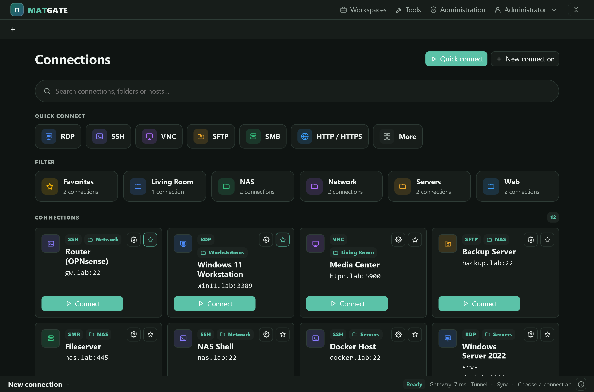
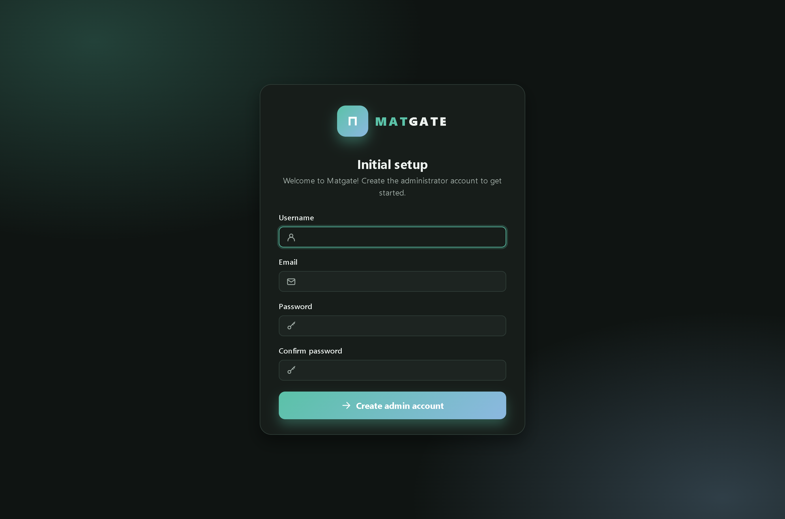
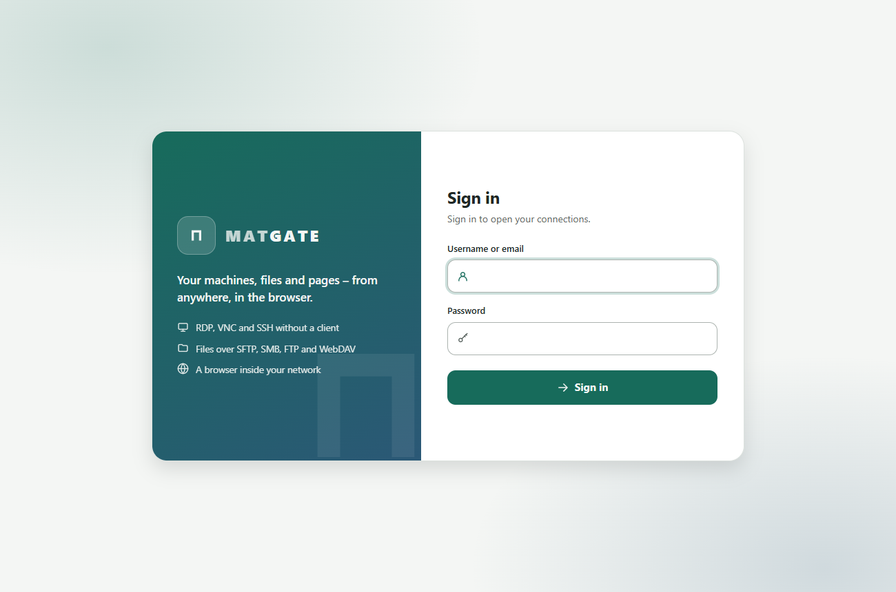
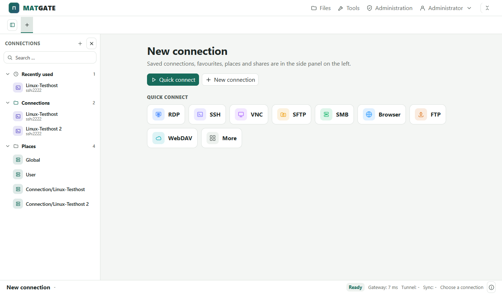
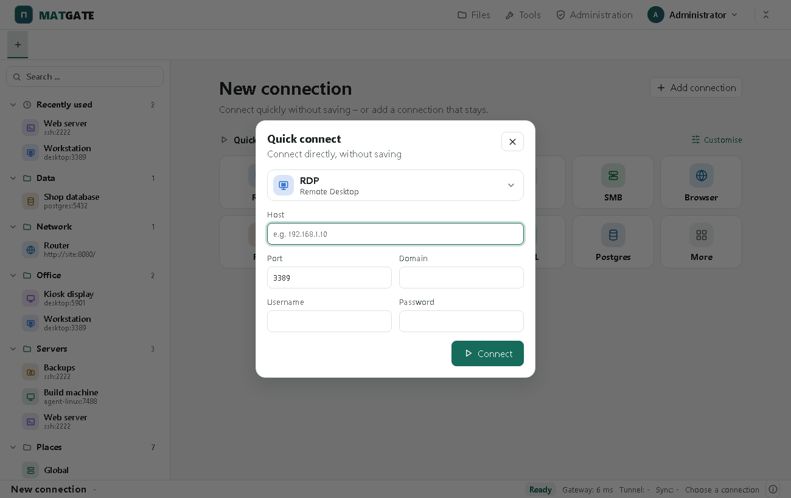
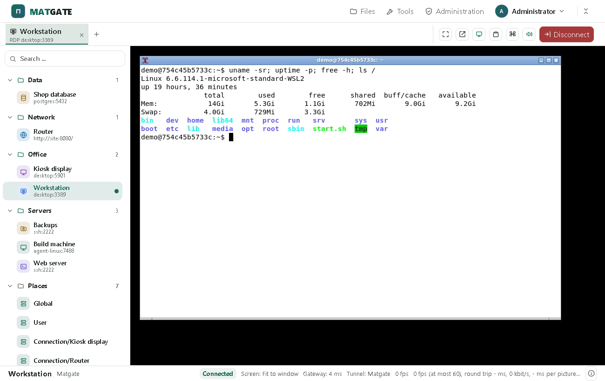
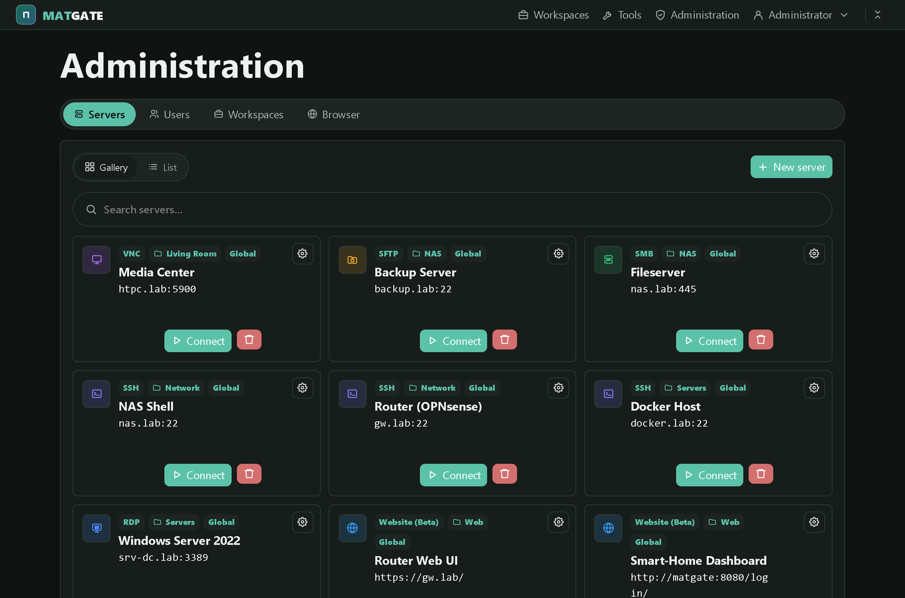
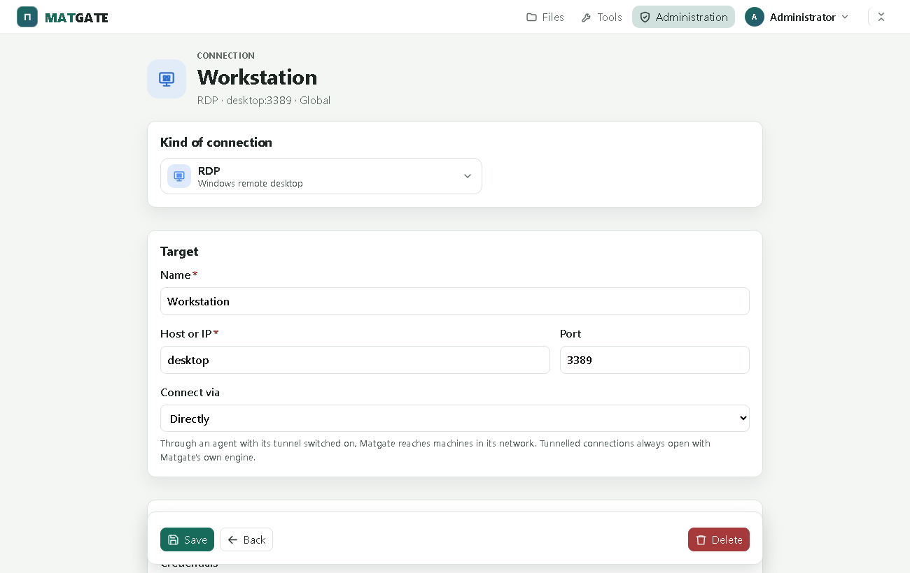
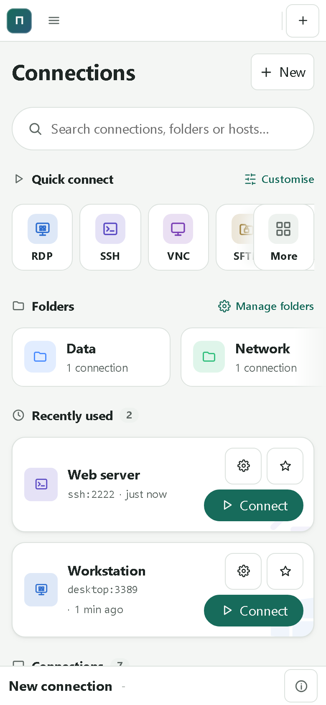

<div align="center">


# Matgate

**One login for your whole home network – in the browser.**

Remote desktops (RDP/VNC), shell (SSH), file access (SFTP/FTP/SMB) and internal web UIs,
behind a single self-hosted gateway. One Docker stack, no cloud, no agents on your machines.

</div>



---

## What this is about

Your home network is full of things you occasionally need to reach: a Windows box over RDP,
a Linux server over SSH, the NAS share, the router's web UI. Normally that means an RDP client
here, an SSH client there, a VPN, a bookmark, a password sheet. Matgate puts all of it behind
**one web UI and one login**: every machine as a tile, every session as a tab, every credential
stored **encrypted** in one place. RDP, VNC and SSH run through Matgate's own engine - its own RDP and VNC
clients, written in C# and part of Matgate itself, the picture shown as H.264 by the browser -; Apache
Guacamole is there as a second way to open them, chosen per connection - or left out altogether. Files, the website proxy,
users, permissions and the UI are Matgate's own.

It is built to sit on a home server in Docker, optionally behind a reverse proxy, and to be
usable from a laptop or a phone – installable as a PWA.

## At a glance

**Remote sessions**
- **RDP, VNC and SSH** in the browser, no client install - through **Matgate's own engine** or through
  **Guacamole**, picked per connection ("Open as"), see [Two engines](#two-engines-for-remote-sessions)
- RDP with a **clipboard for text, pictures and files** in both directions (Ctrl+V puts files into the
  Explorer window that is open), **sound**, and a resolution that **follows the window without reconnecting**
- A password that is not stored is **asked for when connecting**
- The [agent](agent/README.md) also runs on **Linux and macOS** as the system's service: shared folders
  and programs in a terminal (Claude Code in the browser), updated by Matgate
- Through the [agent](agent/README.md): the real desktop of a Windows machine with its **microphone and
  game controllers** taken from the browser (given a virtual audio cable and the ViGEmBus driver there),
  single windows, and a start page with the machine's **own logo**
- Several sessions open at once as **draggable tabs**, with session restore
- **Sessions that outlive the browser** (an option per user, Account -> Session, 5 minutes to 24 hours):
  an RDP, VNC or SSH session of Matgate's own engine keeps running when its browser is reloaded, loses its
  network or is closed, and the page that comes back - on another device too - gets that very session and
  the same tabs; closing a tab ends its session at once
- **Pop a session out into a window of its own** - just that session, no tabs around it - and hand it back
  with one button; the main window lists the windows that are out beside its tabs (great for multi-monitor)
- **Real fullscreen / immersive mode** (safe-area aware on iPhone), clipboard sync, a live status bar
- **A scale instead of a resolution**: "fit to window" at 50 %, 100 %, 150 % ... - a larger desktop shown
  smaller, or a smaller one shown larger; on a phone the **device keyboard** leaves the picture reachable (it
  keeps its size and is moved with two fingers, or the resolution follows the keyboard)
- On phones and tablets a **key bar of your own** under every session: the keys a phone's keyboard does not
  have (Esc, Tab, Ctrl, Alt, the arrows) and your own shortcuts (Ctrl+C, Ctrl+V, ...), set up under
  Account -> Key bar - which buttons, in which order, for desktops, terminals or both
- Per-session **scale** for VNC through Guacamole (Auto / 75% / 50%) so more fits on screen

**Databases**
- **SQL Server, MySQL / MariaDB and PostgreSQL** as connections, opened in one **database browser**: the
  databases with their tables and views, a table's rows a page at a time (a click on a column orders by it),
  and a field for statements of your own. A login that is not stored is asked for

**Files**
- File gateway for **SFTP, FTP and SMB** – no extra privileges in the container
- Upload, download, **zip / unzip**, copy, move, delete, archive extraction
- **Between file tabs as in Explorer**: Ctrl+C / Ctrl+X in one, Ctrl+V in another - also between two
  different connections, folders included - or drag rows onto a folder or onto another file tab (Shift moves);
  the bytes stay on the gateway
- **Preview** for images, video, audio, PDF and text

**Websites**
- **Native** mode for internal admin UIs (router, NAS, hypervisor …): Matgate fetches the pages, the
  browser never talks to the device itself
- Optionally each website **under an address of its own** (`<label>.web.example.com`): the application
  runs unchanged - also the ones that read their own address or send the browser to `/login`, which
  no proxy under a path can show - and stays out of Matgate's origin
  ([how to set it up](#websites-under-an-address-of-their-own))
- A website's **name and password** in the connection: sent where a page asks the browser for them
  (Basic), used to sign in to Proxmox
- **Quick connect without an address is a browser**: a tab with an address bar, every site reached
  through Matgate
- **"via Chromium / Firefox VNC"** fallback: the page opens in a real browser on an optional
  **browser farm** and is streamed over VNC – for pages the plain proxy can't render. Kiosk by
  default, auto-sized to your window, with smart-reconnect on resize

**Organizing & sharing**
- A **side panel** with everything there is to open: favorites, recently used, the connections by folder,
  places and shares - searchable, each group collapsible. One click connects or jumps to the open session,
  Ctrl / middle click opens another one, right click brings the connection's menu. On a desktop it is open
  from the start and the start page beside it is just quick connect; it is shown and hidden from the tab
  row or the view button (normal, normal with side panel, compact), and on a phone it is a sheet from the menu.
  Subfolders are names with a "/"; connections are moved by dragging them onto a folder, and a right click on
  a folder makes a new connection in it
- **Into other networks without a VPN on the gateway**: a connection goes *through* a Matgate agent standing in
  that network (its **tunnel**; the agent can also connect to Matgate itself, so no port has to be open there),
  or *through* a **WireGuard** tunnel - paste the peer configuration; Matgate runs it with wireproxy, as an
  ordinary program, without any rights on the host. Tunnelled connections open with Matgate's own engine
- **Credentials** stored once and chosen in as many connections as you like - a new password in one place
  is the new one for all of them; personal, or shared by an administrator
- **SSH keys** for SSH and SFTP - pasted or read from a file, in a connection or in stored credentials
  (OpenSSH, PEM or PuTTY `.ppk`; the password is the key's passphrase), with Matgate's own engine and Guacamole
- **Quick connect** for ad-hoc sessions without saving anything
- **Folders** with a page of their own (name, icon, which connections lie in them), per-user **favorites**,
  search across names, folders and hosts
- **Workspaces**: shareable bundles with public links, password protection, shared text and file exchange
- Live **network tools**: ping, DNS lookup, port check, streamed download test

**Users & operation**
- Local users with **username + email + password**, a **first-run setup wizard**
- Admin roles and **per-server access control**; global servers and user-owned servers
- **Groups** for a company: members get whole folders (with subfolders and whatever is filed there later) or
  single connections; an administrator makes **folders for everyone**, which are there while still empty
- Credentials **encrypted at rest**; `/guacamole` sits behind the Matgate login
- **English and German**, light / dark (follows the system), installable **PWA**

## Screenshots

### First run, then one login

| Setup wizard | Sign in |
|---|---|
|  |  |

On the very first start a **setup wizard** creates your administrator account; after that it is a
single sign-in.

### Everything to open, on the left



The **side panel** lists favorites, what was used last, the connections by folder, the places of the file
manager and the shares, with a search across all of them. A dot marks a connection with an open session;
clicking it goes there instead of opening a second one. Put the panel away and the start page is the full
list of connection cards again - as it is on a phone, where the panel is a sheet brought by the menu.

### Ad-hoc without saving anything



**Quick connect** starts a one-off RDP/VNC/SSH/website session without creating a saved server. On a phone
the protocols are small tiles and the whole form fits on one screen.

### A live session



Every connection opens as a tab with its own toolbar (fullscreen, clipboard, scale, disconnect)
and a status bar showing tunnel state and latency. Shown here: a website opened in a real browser
through the **browser farm** – the fallback for web UIs the native proxy can't display.

### Administration in one place

| Servers | Users |
|---|---|
|  |  |

Servers as a **gallery or a list**, each with its protocol, folder and scope. The server editor
covers every connection type; websites additionally pick their render mode.



### The optional browser farm


A pool of isolated Chromium/Firefox sessions (each on its own VNC port) powers the
"via … VNC" websites. Pool size and resolution are live-configurable, with active sessions and
a history right in the admin area. It's an **optional** sidecar – without it, only "Native"
websites are offered.

### Light theme and phones

| Light | Phone |
|---|---|
|  |  |

## Quick start

Prebuilt images are published to the GitHub Container Registry:

| Image | Tag | Use it for |
|---|---|---|
| `ghcr.io/real-ttx/matgate` | `latest` | the current release |
| `ghcr.io/real-ttx/matgate` | `0.9.60`, `sha-…` | pinning an exact build |
| `ghcr.io/real-ttx/matgate-browser-farm` | `latest` | the optional browser farm |

Remote sessions have two engines: **Matgate's own** (part of Matgate itself - nothing extra to run)
and **Apache Guacamole** (two containers). A stack can run either or
both; with both, every connection picks one. A small edge proxy is the single entrance, compresses what
Matgate sends and keeps `/guacamole` behind the login. Three ready-made stacks live in this repo —
grab one and run it, no build required:

| File | What you get |
|---|---|
| [`docker-compose.simple.yml`](docker-compose.simple.yml) | RDP, VNC and SSH through Matgate's own engine, files and **native** websites — **without Guacamole**, nothing to configure |
| [`docker-compose.yml`](docker-compose.yml) | **both engines** (a choice per connection), plus the options most installs want: own admin, HTTPS, home DNS, pinned keys |
| [`docker-compose.full.yml`](docker-compose.full.yml) | all of that **plus the browser farm** ("via Chromium / Firefox VNC" websites) |

```bash
docker compose -f docker-compose.simple.yml up -d    # minimal, without Guacamole
docker compose up -d                                 # both engines, with the usual options
docker compose -f docker-compose.full.yml up -d      # everything, browser farm included
```

Open **http://localhost:8088** — the first start shows a **setup wizard** that creates your
administrator account (username, email, password). All three files are self-contained and use the prebuilt
images. **Matgate generates and persists its own keys** (the at-rest key and the one it shares with
Guacamole) into the `matgate-secrets` volume — nothing to configure by hand. For
reference, the whole `docker-compose.simple.yml`:

```yaml
# Matgate, minimal - without Guacamole: RDP, VNC and SSH through Matgate's own engine, file connections,
# native websites. Two small containers: Matgate and the proxy in front of it.
#
#   docker compose -f docker-compose.simple.yml up -d
#
# Open http://localhost:8088 - the first start asks you to create the admin account. Nothing to
# configure: Matgate generates its own keys.
#
# Want Guacamole as well (a choice per connection) and the usual options?  ->  docker-compose.yml
# Want the browser farm on top?                                           ->  docker-compose.full.yml
#
# Coming from an older copy of this file, which ran Guacamole or a separate display engine? Add
# --remove-orphans once, so those containers go.
name: matgate

services:
  # The single entrance on 8088; it also compresses what Matgate sends.
  edge:
    image: caddy:2
    depends_on: [matgate]
    ports:
      - "8088:8088"
    entrypoint:
      - /bin/sh
      - -c
      - |
        printf "%s\n" \
          ":8088 {" \
          "  encode zstd gzip" \
          "  reverse_proxy matgate:8080" \
          "}" > /tmp/Caddyfile && exec caddy run --config /tmp/Caddyfile --adapter caddyfile
    restart: unless-stopped

  matgate:
    image: ghcr.io/real-ttx/matgate:latest
    environment:
      # This stack has no Guacamole: every connection opens with Matgate's own engine, which is part of
      # Matgate itself.
      MATGATE_GUACAMOLE: "off"
    volumes:
      - ./data:/data
      - matgate-files:/files
      - matgate-secrets:/run/matgate-secrets
    extra_hosts:
      - "host.docker.internal:host-gateway"
    restart: unless-stopped

volumes:
  # The encryption keys. Back this up - without it, stored device passwords cannot be decrypted.
  matgate-secrets:
  # Files exchanged with sessions. Point it at a path of your own to keep them elsewhere.
  matgate-files:
```

After the first admin is created you add your first server and connect.

> `docker-compose.yml` can also build Matgate from this repository instead of
> pulling the published images — that is what `docker compose up --build -d` does. Ignore it unless you
> work on Matgate.

### Two engines for remote sessions

Every RDP, VNC and SSH connection has an **Open as** setting - its sub type, as a website has its render
mode:

| | **Matgate** (own engine) | **Guacamole** |
|---|---|---|
| RDP | Matgate's own RDP client (TLS and Network Level Authentication with NTLM), the picture as H.264 decoded by the browser (WebCodecs) | guacd and the Guacamole client |
| RDP clipboard | text, pictures and **files**, both ways: Ctrl+V puts files where the remote desktop has its focus, files copied there are offered for download | text; files through the session's drive |
| RDP window size | the session follows the window without reconnecting (Display Control) | reconnects at the new size |
| RDP sound, drive | sound; no drive yet | the drive `Files` with the file areas |
| VNC | Matgate's own VNC client (VNC password, VeNCrypt, Apple Remote Desktop sign-in); text clipboard; the desktop is resized to the window where the server can | guacd; per-session scale |
| SSH | in Matgate itself (SSH.NET, xterm.js); asks for a missing user or password in the terminal; files pasted or dropped go to the home folder by SFTP | Guacamole's terminal; files through its SFTP dialog |
| Needs | nothing - it is part of Matgate | the `guacd` and `guacamole` containers |

What a connection asks for is what opens it. Only when that engine is not part of the installation
does the other one step in - a stack without Guacamole opens everything with Matgate's own - and the
connection form says so.
"Via Chromium / Firefox VNC" websites are shown by Guacamole, so they need it (and the browser farm).
Matgate's own engine needs a browser with WebCodecs: a current Edge, Chrome, Firefox or Safari.
Guacamole remains the way for what Matgate's RDP client does not do yet: a drive in the session,
terminal servers that hand out Remote Desktop licences, sign-in through Kerberos only, and servers
that only know the old RDP encryption or the CredSSP scheme from before 2018.

### Pin your keys (recommended)

Matgate generates its secrets on first start into the `matgate-secrets` volume:

- `master.key` – encrypts stored device passwords **at rest**
- `guac.key` – signs the Guacamole session tokens (**must match** between `matgate` and `guacamole`)

If that volume is ever lost or recreated, new keys are generated and the **stored passwords can no
longer be decrypted**. To make the keys survive any redeploy, pin the current values into a `.env`
next to the compose file – once, non-destructively:

```bash
docker exec matgate-matgate-1 sh -c \
  'printf "MATGATE_GUACAMOLE_JSON_SECRET_KEY=%s\nMATGATE_SECRET_KEY=%s\n" \
   "$(cat /run/matgate-secrets/guac.key)" "$(cat /run/matgate-secrets/master.key)"' >> .env

docker compose up -d
```

From then on the keys come from `.env` and never regenerate. `MATGATE_GUACAMOLE_JSON_SECRET_KEY`
is 32 hex characters, `MATGATE_SECRET_KEY` is 64.

## Configuration

| Variable | Default | Meaning |
|---|---|---|
| `MATGATE_DATA_DIR` | `/data` | Persistent data directory inside the container |
| `MATGATE_ADMIN_USER` / `MATGATE_ADMIN_PASSWORD` / `MATGATE_ADMIN_EMAIL` | – | Seed the admin unattended and skip the setup wizard |
| `MATGATE_GUACAMOLE` | on | `off` for a stack without Guacamole: every connection opens with Matgate's own engine |
| `MATGATE_GUACAMOLE_JSON_SECRET_KEY` | auto | 32 hex chars for Guacamole JSON auth (see *Pin your keys*) |
| `MATGATE_SECRET_KEY` | auto | 64 hex chars for at-rest encryption of credentials |
| `MATGATE_REQUIRE_HTTPS` | `false` | Force HTTPS / secure cookies behind a TLS proxy |
| `MATGATE_WEBSITE_HOST` | – | Host names for websites, like `*.web.example.com` - see *Websites under an address of their own* |
| `MATGATE_DNS_SERVER` / `MATGATE_DNS_SEARCH` | – | Point the containers at your home DNS so `nas`, `pc-terminal`, … resolve |
| `BrowserFarm__BaseUrl` | `http://browser-farm:8090` | Where the optional browser farm lives |

## Websites under an address of their own

A natively opened website is fetched by Matgate and handed to the browser. There are two ways to do that.

**Under a path of Matgate's address** (`https://matgate.example.com/website/<id>/…/proxy/`) is what works
with nothing but the one host name Matgate has. Every address in the pages is rewritten to fit. That is
enough for pages that only link to themselves. It cannot work for an application that reads its own
address - one that takes its route from the path, or sends the browser to `/login` at the root: the
root is Matgate's, and a page cannot be told otherwise. UniFi is one of those.

**Under a host name of its own** (`https://<label>.web.example.com/`) the website's paths are its own,
its cookies and storage are the browser's own for that address, and nothing in it has to be rewritten.
Its scripts also run in an origin that is not Matgate's. It needs three things, once, for all websites:

1. A **wildcard DNS** record that points to the same place as Matgate's own name: `*.web.example.com`.
2. A **certificate** for that wildcard, and a **route in your reverse proxy** that sends those names to
   Matgate, host name unchanged. One route, not one per website.
3. `MATGATE_WEBSITE_HOST=*.web.example.com` - the pattern, with the `*` where Matgate puts a label of
   20 letters and digits. `web-*.example.com` works too, and so does `*.example.com` when the wildcard
   you already have catches everything that has no route of its own.

The names must belong to the **same site** as Matgate's own (the same registered domain: `matgate.example.com`
and `*.web.example.com`). A browser keeps cookies for a framed page only within one site; where it does
not, the shell notices and falls back to the path. Locally `*.mg.localhost` with Matgate opened as
`http://mg.localhost:8088` works without any DNS.

Who gets in: the label says which user and which connection, and a cookie for that one host name -
handed out against a one-time ticket by the shell - says that the browser is that user's. Signing out,
deleting the connection or switching the account off closes the address. A connection reaches its own
machine only (also under another port, as after a redirect from http to https); a quick-connect tab is a
browser and reaches whatever its user types. With only one host name Matgate keeps working as before; a
connection can also ask for the path explicitly ("Open under Matgate's own address").

## Data & persistence

Everything lives under the data directory (`./data` in the examples, mounted at `/data`):

```
/data
├─ users.json               local users, permissions, favorites
├─ servers.json             global + user-owned servers and folders
├─ workspaces.json          workspace definitions and share settings
├─ guacamole.properties     generated Guacamole config
└─ user-mapping.xml         generated Guacamole mapping (no cleartext credentials)
```

Files people exchange with their sessions do **not** live here - they have their own tree, see below.

## File areas

Files exchanged with a session live in their own volume (`matgate-files`), apart from the gateway state:

```
/files
├─ global/                  shared by everyone who is allowed in
├─ connection/<id>/         belongs to one connection, shared by everyone who may open it
├─ user/<id>/               private to one user, the same in every session
└─ session/<id>/            one session - this is what the session sees as its drive
```

An RDP session gets a redirected drive named **Matgate**, and inside it the areas the user is allowed
to use, next to a `Session` folder for this sitting alone:

```
Matgate (drive)
├─ Global/        ─┐
├─ Connection/     ├─ only those the user has been given
├─ User/          ─┘
└─ Session/        always there, gone when the session is
```

Every area is its own subtree, so you can put the whole thing on a NAS by pointing the volume at a
path of your own, or move a single area by mounting over `/files/global`. Nothing above cares.

### Who gets what

An admin decides per user, under *Administration → Users*: each area is either handed over or not
there at all. There is no read-only in between, and that is deliberate - the drive is served to every
session by a single system user, so the filesystem cannot tell two Matgate users apart and a
"read-only" would look like a guarantee without being one.

Two things worth knowing:

- **Changes take effect on the next connect.** A running session keeps the folders it was given.
- **Quick connect gets `Session` only.** Its target host is typed in at connect time, so linking a
  persistent area into one would let anyone mount the shared store into a machine of their choosing.
- The areas are mounted **into the remote machine**. Anyone else with a session on that machine can
  reach them - that is how drive redirection works, on any gateway.

### Setup

The shipped compose files give the volume to matgate **and** to guacd, which serves the drive of a
Guacamole session, at the same path. Both halves are needed: guacd serves the drive from its own
filesystem, and matgate assembles the folder it serves. If you write your own compose file and skip
this, nothing breaks - Matgate notices that the tree is not shared and a Guacamole session falls back
to a scratch folder inside guacd, so file transfer keeps working with the `Session` folder alone. A
session of Matgate's own engine has no drive yet; files go through its clipboard. The gateway log says
which of the two is in use at startup.

Session folders are cleaned up on their own. A session of Matgate's own engine runs through Matgate,
which removes the folder when the session ends. For a Guacamole session the browser reports it as open
while its tab lives, and a folder goes once it stops reporting: Matgate is never told that such a
session ended - the tunnel runs between the browser and Guacamole - so without that report a folder is
only removed after it has been untouched for long enough that no tab can still be using it.

The encryption keys live **outside** `./data` in the `matgate-secrets` volume, so a stolen `./data`
backup can't decrypt your device passwords. Back up **both** the data directory and the secrets
volume (or pin the keys in `.env`, see above).

## Permission model

- `Admin` manages users and all servers
- `CanManageServers` manages global servers, `CanCreateServers` may create own servers
- `ServerAccessAll`, or access granted per individual global server
- **Global** servers are shared and admin-managed; **Own** servers belong to a user (still visible
  to admins for support)

## How it's built

- **ASP.NET Core (.NET 10)**, server-rendered HTML; the client is **plain JavaScript**, no build step
- **RDP / VNC** by Matgate's own clients (`Matgate/Display`, C#, written from Microsoft's and the RFB
  specification), encoded as H.264 with OpenH264 and speaking the screen protocol of the
  [Matgate agent](agent/README.md), shown by the browser with WebCodecs; **SSH** in-process (SSH.NET) in an
  xterm.js terminal
- …or through **Apache Guacamole + guacd**, for which Matgate mints short-lived, encrypted auth tokens
  per launch
- File access through in-process **SFTP (SSH.NET)**, **FTP (FluentFTP)** and **SMB (SMBLibrary)**
- The **browser farm** is a small stdlib-Python control API over a pool of `Xvfb + x11vnc + browser`
  slots – no Docker socket, isolated per Linux user
- Data is stored as JSON files; device passwords are encrypted with AES-GCM

## Status

Matgate is an actively developed self-hosted project. Working today: remote sessions with tabs and
session restore - through its own engine or Guacamole -, the file gateway, the native + browser-farm website modes, quick connect, folders
and favorites, workspaces with sharing, network tools, the setup wizard and per-server access
control, PWA and mobile layout. On the list: TLS polish and further hardening.

## Development

```bash
docker compose up --build -d                     # build this checkout and run it
docker compose -f docker-compose.full.yml up -d  # with the browser farm
```

```bash
dotnet build Matgate/Matgate.csproj      # build without Docker
```

Images are built and published by GitHub Actions on pushes and tags (amd64 + a separate arm64
image).

## License

Matgate is licensed under the MIT License. See [LICENSE](LICENSE).
