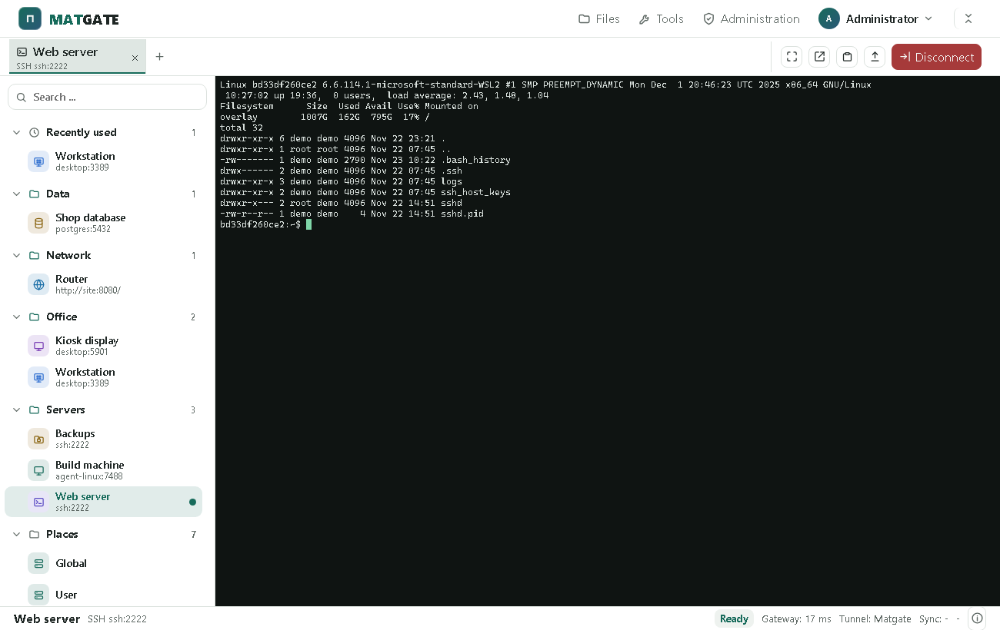
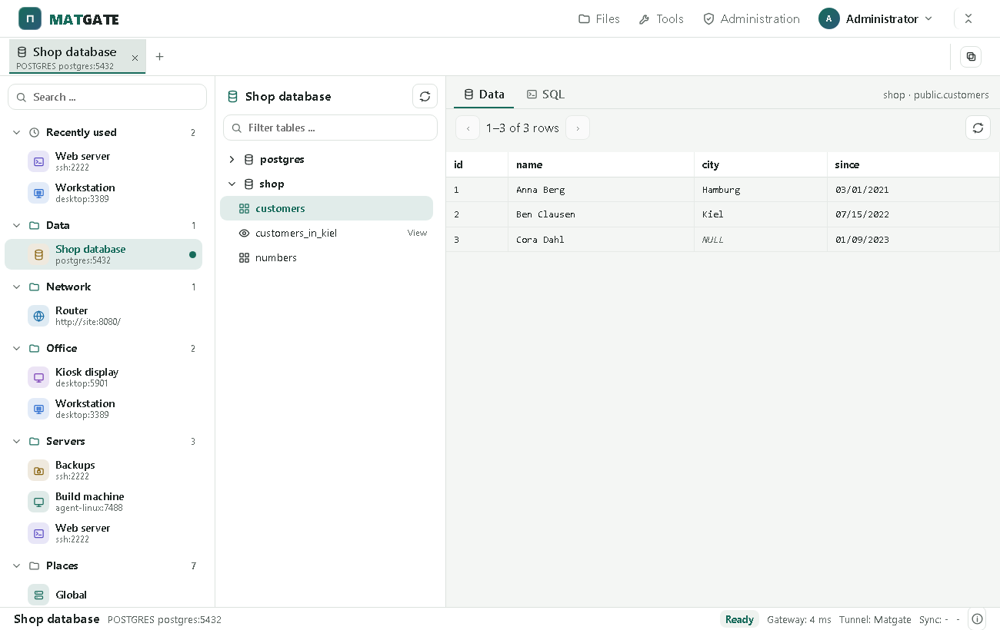
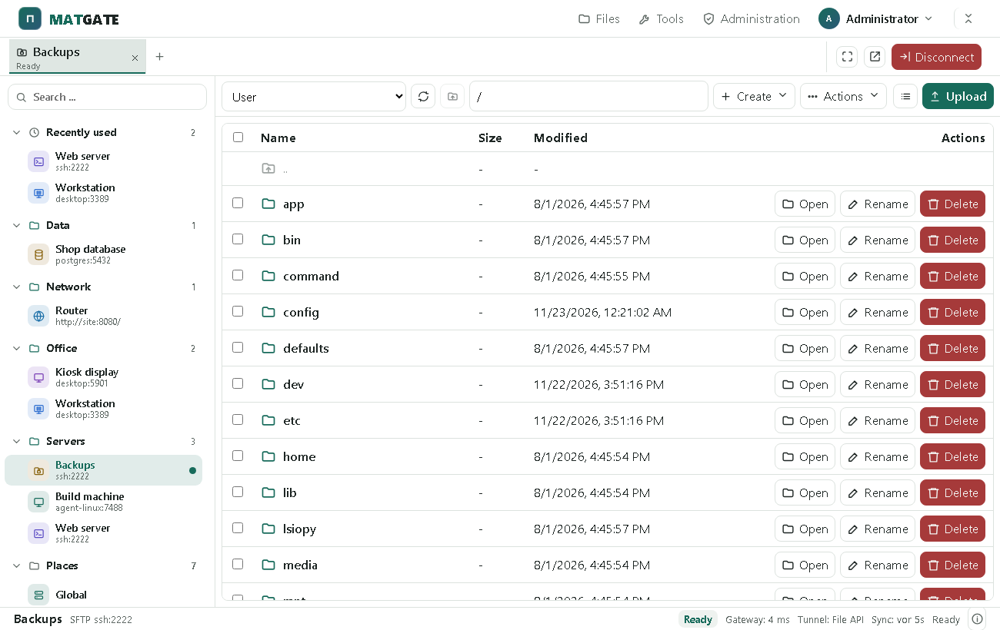
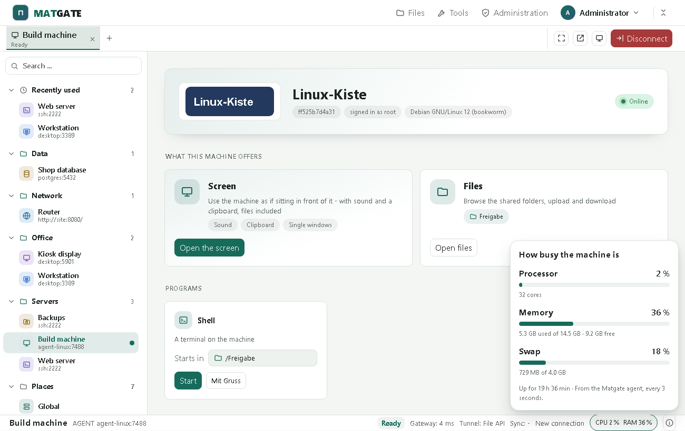
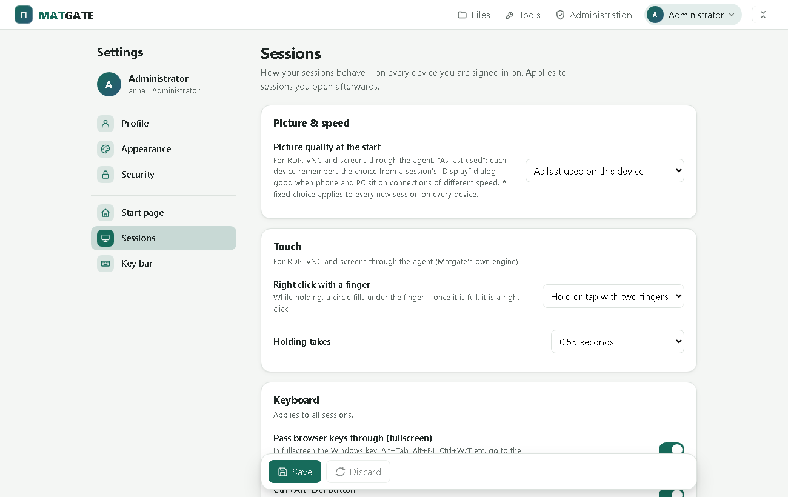
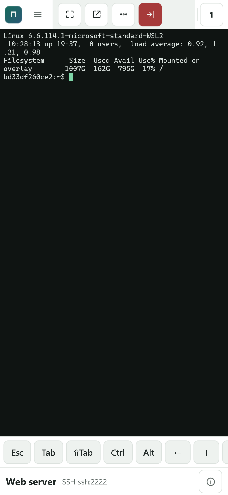
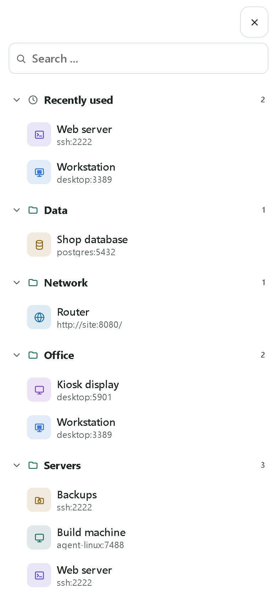
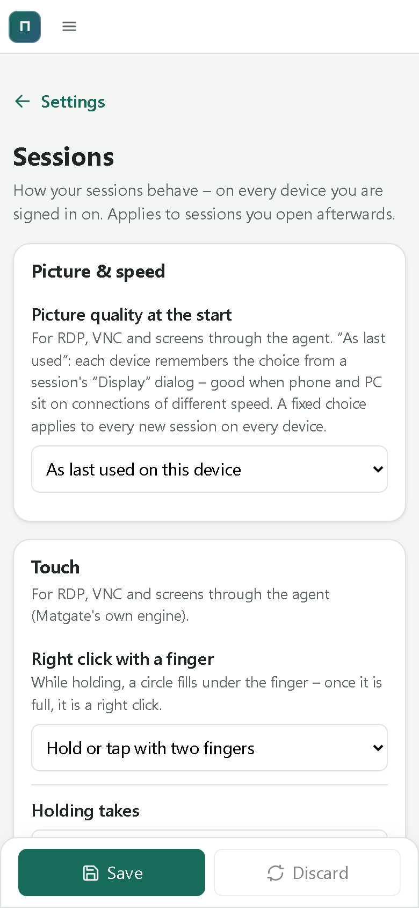
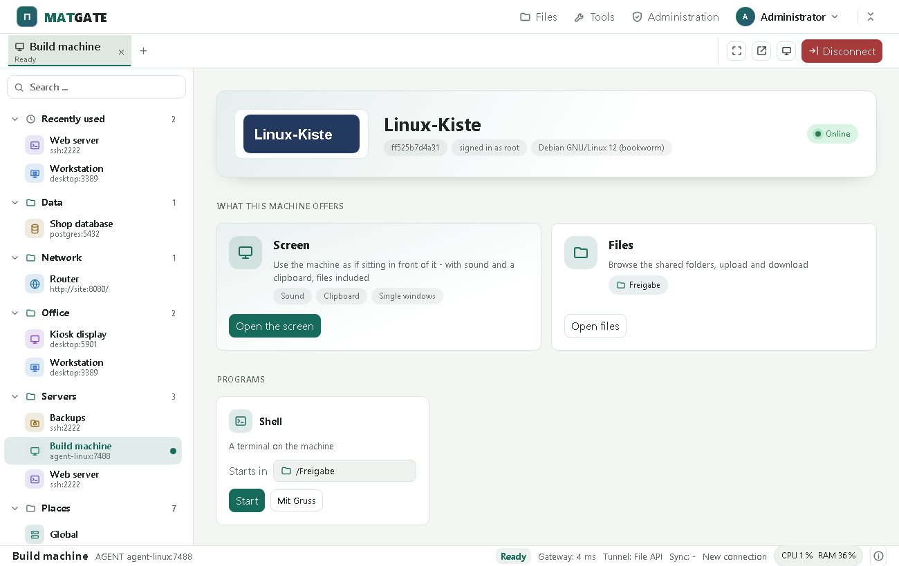

<div align="center">


# Matgate

### One login for your whole network – in the browser.

Remote desktops, terminals, files, databases and internal web UIs behind one self-hosted gateway.<br/>
One Docker stack. No cloud. No client to install.

[](https://github.com/Real-TTX/Matgate/actions/workflows/docker-image.yml)
[](https://github.com/Real-TTX/Matgate/actions/workflows/agent.yml)


[](LICENSE)

**[Quick start](#-quick-start)** ·
**[Features](#-features)** ·
**[Screenshots](#-screenshots)** ·
**[Agent](agent/README.md)** ·
**[Configuration](#%EF%B8%8F-configuration)**

<br/>


</div>

---

## 💡 Why Matgate

Your network is full of things you sometimes need to reach: a Windows box over RDP, a Linux server over
SSH, the NAS share, a database, the router's web UI. Usually that means an RDP client here, an SSH client
there, a VPN, a bookmark and a password list.

Matgate puts all of it behind **one web UI and one login**. Every machine is a tile, every session is a
tab, and every credential is stored **encrypted** in one place. It runs on a home or office server in
Docker, works from a laptop or a phone, and can be installed as an app (PWA).

<table>
<tr>
<td width="33%" valign="top">

**🖥️ Remote sessions**<br/>
RDP, VNC and SSH through Matgate's own engine (H.264 in the browser) or Apache Guacamole.

</td>
<td width="33%" valign="top">

**📁 Files**<br/>
SFTP, FTP, SMB and agent folders in one file manager: copy between connections, zip, preview.

</td>
<td width="33%" valign="top">

**🌐 Websites**<br/>
Internal admin UIs through Matgate's proxy, each under its own address if you like, plus a built-in browser.

</td>
</tr>
<tr>
<td valign="top">

**🛰️ Agent**<br/>
A small program for Windows, Linux and macOS: screen, terminals (Claude Code), folders, a tunnel, CPU/RAM.

</td>
<td valign="top">

**🗄️ Databases**<br/>
SQL Server, MySQL/MariaDB and PostgreSQL: tables, rows and your own statements.

</td>
<td valign="top">

**🔐 Users & groups**<br/>
Levels from read-only to manage, inherited through folders, groups, "who has access and why", encryption at rest.

</td>
</tr>
</table>

---

## 🚀 Quick start

```bash
curl -fsSLO https://raw.githubusercontent.com/Real-TTX/Matgate/main/docker-compose.simple.yml
docker compose -f docker-compose.simple.yml up -d
```

Open **http://localhost:8088**. On the first start a **setup wizard** creates your administrator account.
Then add your first connection and click it. Matgate **generates and keeps its own keys**, so there is
nothing to configure.

Three ready-made stacks are in this repo, all with prebuilt images:

| File | What you get |
|---|---|
| [`docker-compose.simple.yml`](docker-compose.simple.yml) | RDP, VNC and SSH through Matgate's own engine, files, native websites. **Without Guacamole**, nothing to configure |
| [`docker-compose.yml`](docker-compose.yml) | **Both engines** (a choice per connection), plus the usual options: own admin, HTTPS, home DNS, pinned keys |
| [`docker-compose.full.yml`](docker-compose.full.yml) | All of that **plus the browser farm** ("via Chromium / Firefox VNC" websites) |

| Image | Tag |
|---|---|
| `ghcr.io/real-ttx/matgate` | `latest`, a version such as `0.44.0`, or `sha-…` |
| `ghcr.io/real-ttx/matgate-browser-farm` | `latest` (optional) |

<details>
<summary><b>The whole <code>docker-compose.simple.yml</code></b></summary>

```yaml
name: matgate

services:
  # The single entrance on 8088; it also compresses what Matgate sends.
  edge:
    image: caddy:2
    depends_on: [matgate]
    ports:
      - "8088:8088"
    entrypoint:
      - /bin/sh
      - -c
      - |
        printf "%s\n" \
          ":8088 {" \
          "  encode zstd gzip" \
          "  reverse_proxy matgate:8080" \
          "}" > /tmp/Caddyfile && exec caddy run --config /tmp/Caddyfile --adapter caddyfile
    restart: unless-stopped

  matgate:
    image: ghcr.io/real-ttx/matgate:latest
    environment:
      # No Guacamole in this stack: every connection opens with Matgate's own engine.
      MATGATE_GUACAMOLE: "off"
    volumes:
      - ./data:/data
      - matgate-files:/files
      - matgate-secrets:/run/matgate-secrets
    extra_hosts:
      - "host.docker.internal:host-gateway"
    restart: unless-stopped

volumes:
  # The encryption keys. Back this up - without it, stored passwords cannot be decrypted.
  matgate-secrets:
  # Files exchanged with sessions. Point it at a path of your own to keep them elsewhere.
  matgate-files:
```

</details>

> [!TIP]
> Pin your keys once so they survive any redeploy - see [Pin your keys](#-pin-your-keys).

---

## ✨ Features

### 🖥️ Remote sessions

- **RDP, VNC and SSH in the browser.** Use Matgate's own engine or Guacamole, chosen per connection
  ([compare them](#-two-engines)).
- **RDP clipboard for text, pictures and files**, both ways. Ctrl+V puts files into the Explorer window that
  is open on the remote desktop. Sound works, and the resolution **follows the window without reconnecting**.
- **The clipboard, for the session in front**: the status bar shows what is on this device's clipboard ("Picture ·
  PNG 1280×720", "Text · 42 characters") - only while there is something. A click (or the toolbar's clipboard
  button) opens a panel with a preview and what to do with it: a picture as a PNG or JPG file, as a picture or
  downloaded; text as text, typed, or as a TXT file, edited first; or something else typed in or picked. RDP and
  the agent's screen get files as real files on their clipboard, SSH in the shell's current folder (OSC 7; else
  the home) with the path typed, a Guacamole session through its drive.
- **Tabs** that you can drag, and **sessions that outlive the browser**. A reload, a lost network or a closed
  app finds the very same session again, on another device too.
- **Already open?** If you open a connection that already has a session somewhere, Matgate asks whether to
  *bring it here* or start a *new session*, so the same Windows user is not signed in twice.
- **Fastest response** quality: fewer colours (16 bit) and short buffers for the lowest latency.
- **Pop a session out** into a window of its own and hand it back with one click, handy on several monitors.
- **Real fullscreen** (safe-area aware on iPhone), clipboard sync and a live status bar with latency.
- **A scale instead of a resolution**: fit to window at 50 %, 100 %, 150 %, …
- **A password that is not stored** is asked for when connecting.

### 📱 On phones and tablets

- **Touchpad or direct touch**, pinch to zoom, two fingers to scroll.
- **Right click you can see**: hold a finger still and a ring fills up. When it is full, it is a right
  click. Choose hold, two-finger tap or both, and how long to hold, under *Settings → Sessions → Touch*.
- **A key bar of your own** under every session: Esc, Tab, Ctrl, Alt, the arrows and your own shortcuts.
- The **device keyboard** leaves the picture reachable. Quick connect is one row to swipe.

### 🛰️ The Matgate agent

A small program on a machine that Matgate connects to, or that connects to Matgate (no open port
needed). [→ Agent documentation](agent/README.md)

- **The real screen** of a Windows or Linux machine (sign-in screen included) and a first version for macOS.
- **Microphone and game controllers** from the browser on Windows (Xbox 360 controller with rumble).
- **Programs in a terminal**, for example **Claude Code** or PowerShell, which keep running without a browser.
- **Shared folders** in the file manager, and a **tunnel** into the agent's network.
- **How busy the machine is**: CPU and RAM in the status bar, on a phone too. Click it for memory in
  MB/GB, swap and uptime.
- **Updates itself** through Matgate. The agent needs no internet access of its own.

### 📁 Files

- **SFTP, FTP and SMB**, with no extra privileges in the container.
- Upload, download, **zip / unzip**, copy, move, delete.
- **Between file tabs as in Explorer**: Ctrl+C in one tab, Ctrl+V in another, even between different
  connections. You can also drag rows onto a folder or a tab.
- **Preview** for images, video, audio, PDF and text.

### 🌐 Websites

- **Native** mode for internal admin UIs (router, NAS, hypervisor, …). Matgate fetches the pages, so the
  browser never talks to the device itself.
- **An address of its own** per website (`<label>.web.example.com`), for apps that no path proxy can show
  ([setup](#-websites-under-an-address-of-their-own)).
- **Name and password** in the connection, used for Basic auth and the Proxmox sign-in.
- **A built-in browser**: quick connect without an address opens a tab with an address bar.
- **Browser farm** (optional): the page opens in a real Chromium or Firefox and is streamed over VNC.

### 🗄️ Databases

- **SQL Server, MySQL / MariaDB and PostgreSQL** in one small **SQL studio**: an object explorer with
  databases, tables and views (columns, keys, indexes, foreign keys), procedures and functions, each with a
  menu - rows, a SELECT, **script as CREATE**, the structure.
- A real **SQL editor** (CodeMirror, served by Matgate itself): colours per server, **completion** of tables and
  columns, queries in tabs that are there again after a reload, run the **selection** (Ctrl+Enter / F5),
  **several results**, **cancel**, a **history**, and **export** of every row as CSV or JSON.
- Rows a page at a time, sorted by a column. **Read only** stays read only, in the editor too.
- Also through **quick connect**, with nothing saved.

### 🗂️ Organizing & sharing

- A **side panel** with favorites, recently used, folders, places and shares, all searchable. A dot marks
  an open session.
- **Into other networks without a VPN on the gateway**: through an agent's tunnel or through a
  **WireGuard** peer (run by wireproxy, without any rights on the host).
- **Credentials** stored once and used in many connections, personal or shared by an administrator.
- **SSH keys** (OpenSSH, PEM or PuTTY `.ppk`) for SSH and SFTP.
- **Folders** with icons, per-user **favorites**, search across names, folders and hosts.
- **Drag to sort**: drag a connection in the side panel or on the start page to put it in **your own order**
  (nobody else's changes), or onto another folder to move it there (for whoever may edit it). Mouse on the
  whole row, a finger on its grip.
- **Workspaces**: bundles to share, with public links, password protection, shared text and file exchange.
- Live **network tools**: ping, DNS lookup, port check, download test.

### 🔐 Users & operation

- Local users with username, email and password, plus a **first-run setup wizard**. **Single sign-on** with MatIdentity and Microsoft Entra ID, with their groups mapped onto Matgate groups.
- **Permissions with levels and inheritance**: read only, connect, edit or manage - per connection, per folder (and everything below) or on all connections, for users and groups. Every connection and folder shows **who has access and why**.
- **Groups** with members; **read only** really is read only - screen and terminal only to watch, files and SQL only to read.
- Credentials **encrypted at rest** (AES-GCM). `/guacamole` sits behind the Matgate login.
- **One settings page** with sections. A save bar shows what is unsaved. Light, dark or system theme
  with your own colours.
- **English and German**, installable **PWA**.

---

## 📸 Screenshots

As in the picture at the top, every connection opens as a tab with its own toolbar (fullscreen, clipboard, display, keyboards, sound,
disconnect) and a status bar with tunnel state and latency. The side panel on the left lists everything
there is to open; a dot marks an open session.

<table>
<tr>
<td width="50%"><br/><sub><b>SSH</b> in Matgate's own terminal</sub></td>
<td width="50%"><br/><sub><b>Databases</b>: tables, rows and your own SQL</sub></td>
</tr>
<tr>
<td><br/><sub><b>Files</b> over SFTP, FTP, SMB, WebDAV and the agent</sub></td>
<td><br/><sub>An <b>agent</b>: screen, files, programs, and how busy it is</sub></td>
</tr>
<tr>
<td><br/><sub><b>Quick connect</b>: a one-off session, nothing saved</sub></td>
<td><br/><sub>The <b>connection editor</b>, one for every type</sub></td>
</tr>
<tr>
<td><br/><sub><b>Settings</b> in sections, here the touch right click</sub></td>
<td><br/><sub>One <b>sign-in</b> for everything</sub></td>
</tr>
</table>

### On a phone

<table>
<tr>
<td width="25%"></td>
<td width="25%"></td>
<td width="25%"></td>
<td width="25%"></td>
</tr>
<tr>
<td align="center"><sub>Start page</sub></td>
<td align="center"><sub>Remote desktop</sub></td>
<td align="center"><sub>Side panel</sub></td>
<td align="center"><sub>Settings</sub></td>
</tr>
</table>

### The agent

<table>
<tr>
<td width="50%"><br/><sub>An agent's <b>start page</b>: screen, terminals, folders</sub></td>
<td width="50%"><br/><sub>The <b>setup</b> on Windows, Linux and macOS</sub></td>
</tr>
</table>

---

## 🔀 Two engines

Every RDP, VNC and SSH connection has an **Open as** setting:

| | **Matgate** (own engine) | **Guacamole** |
|---|---|---|
| RDP | Matgate's own RDP client (TLS, NLA with NTLM), the picture as H.264 decoded by the browser (WebCodecs) | guacd and the Guacamole client |
| RDP clipboard | text, pictures and **files**, both ways | text; files through the session's drive |
| RDP window size | follows the window without reconnecting (Display Control) | reconnects at the new size |
| RDP sound, drive | sound; no drive yet | the drive `Files` with the file areas |
| VNC | own client (VNC password, VeNCrypt, Apple Remote Desktop); text clipboard; resizes where the server can | guacd; per-session scale |
| SSH | in Matgate (SSH.NET, xterm.js); asks for a missing user or password; pasted files go to the home folder | Guacamole's terminal; files through its SFTP dialog |
| Needs | nothing, it is part of Matgate | the `guacd` and `guacamole` containers |

The engine a connection asks for is the one that opens it. If that engine is not installed, the other one
takes over, and the connection form says so. "Via Chromium / Firefox VNC" websites need Guacamole and the
browser farm. Matgate's own engine needs a browser with WebCodecs: a current Edge, Chrome, Firefox or
Safari.

Guacamole is still the way for what Matgate's RDP client does not do yet: a drive in the session, terminal
servers that hand out Remote Desktop licences, sign-in through Kerberos only, and servers that only know
the old RDP encryption or the CredSSP scheme from before 2018.

---

## ⚙️ Configuration

| Variable | Default | Meaning |
|---|---|---|
| `MATGATE_DATA_DIR` | `/data` | Persistent data directory inside the container |
| `MATGATE_ADMIN_USER` / `_PASSWORD` / `_EMAIL` | – | Create the admin unattended and skip the setup wizard |
| `MATGATE_GUACAMOLE` | on | `off` for a stack without Guacamole |
| `MATGATE_GUACAMOLE_JSON_SECRET_KEY` | auto | 32 hex characters for Guacamole JSON auth |
| `MATGATE_SECRET_KEY` | auto | 64 hex characters for the encryption of stored credentials |
| `MATGATE_REQUIRE_HTTPS` | `false` | Force HTTPS and secure cookies behind a TLS proxy |
| `MATGATE_WEBSITE_HOST` | – | Host names for websites, like `*.web.example.com` |
| `MATGATE_DNS_SERVER` / `MATGATE_DNS_SEARCH` | – | Your home DNS, so names like `nas` or `pc-terminal` resolve |
| `BrowserFarm__BaseUrl` | `http://browser-farm:8090` | Where the optional browser farm lives |

### 🪪 Single sign-on

Both are optional and can be on at the same time. The sign-in page then has a button for each.

| Variable | Meaning |
|---|---|
| `MATIDENTITY_AUTHORITY` / `_CLIENT_ID` / `_CLIENT_SECRET` | Sign in with **MatIdentity**. Redirect URI: `https://<matgate>/signin-oidc` |
| `MATIDENTITY_INTERNAL_URL` | Where Matgate itself reaches MatIdentity, when that is not the public address (a container next to it) |
| `MATGATE_ENTRA_TENANT_ID` / `_CLIENT_ID` / `_CLIENT_SECRET` | Sign in with **Microsoft Entra ID**. Redirect URI: `https://<matgate>/signin-entra` |
| `MATGATE_SSO_ONLY` | `true` hides the password form; `/login?local=1` still shows it, as the way in when the service is down |

- **Someone new** gets a Matgate user on the first sign-in, with **no rights**. Those come from groups.
- **An existing user** with the same e-mail address is linked only after **its password** has been entered
  once. The address alone does not prove that it is the same person.
- **Groups**: a Matgate group can be linked to groups of the service, one per line, like
  `matidentity:Technik` or `entra:<group object id>`. At every sign-in the user is put into the linked groups
  the service names, and taken out of those it no longer names. The user page shows the exact values the
  service sent last.
- **MatIdentity** sends the groups when *Send the person's groups to the app* is ticked on the app's access
  page.
- **Entra** sends them once the app registration has a *groups claim* (Token configuration). App roles count
  as well, as `entra:<role>`. With more than 200 groups Entra sends none: choose *Groups assigned to the
  application* there.
- A second factor is the service's business. Matgate's own TOTP applies to its password sign-in.

### 🔑 Pin your keys

On the first start Matgate puts two keys into the `matgate-secrets` volume:

- `master.key` encrypts stored passwords **at rest**.
- `guac.key` signs the Guacamole session tokens and **must match** between `matgate` and `guacamole`.

If that volume is lost, new keys are made and the **stored passwords can no longer be decrypted**. Pin the
current keys into a `.env` next to the compose file, once:

```bash
docker exec matgate-matgate-1 sh -c \
  'printf "MATGATE_GUACAMOLE_JSON_SECRET_KEY=%s\nMATGATE_SECRET_KEY=%s\n" \
   "$(cat /run/matgate-secrets/guac.key)" "$(cat /run/matgate-secrets/master.key)"' >> .env

docker compose up -d
```

From then on the keys come from `.env` and are never made again.

### 🌍 Websites under an address of their own

A native website can be shown in two ways.

**Under a path of Matgate's address** (`https://matgate.example.com/website/<id>/…/proxy/`) works with
nothing but Matgate's own host name. Matgate rewrites every address in the pages. That is enough for pages
that only link to themselves. It cannot work for apps that read their own address or send the browser to
`/login` at the root. UniFi is one of those.

**Under a host name of its own** (`https://<label>.web.example.com/`) the website keeps its own paths,
cookies and storage, and nothing has to be rewritten. Its scripts also run outside Matgate's origin. It
needs three things, once, for all websites:

1. A **wildcard DNS** record that points where Matgate's own name points: `*.web.example.com`.
2. A **certificate** for that wildcard and **one route in your reverse proxy** that sends those names to
   Matgate with the host name unchanged.
3. `MATGATE_WEBSITE_HOST=*.web.example.com`. Matgate puts a 20-character label where the `*` is.
   `web-*.example.com` works too, and so does `*.example.com` if your wildcard already catches everything.

The names must belong to the **same site** as Matgate (the same registered domain), because browsers only
keep cookies for a framed page within one site. If they do not, Matgate falls back to the path. Locally,
`*.mg.localhost` with Matgate opened as `http://mg.localhost:8088` works without any DNS.

Access is checked per host: the label names the user and the connection, and a cookie for that host name
(handed out against a one-time ticket) proves the browser is that user's. Signing out, deleting the
connection or switching the account off closes the address. A connection can also ask for the path
explicitly ("Open under Matgate's own address").

---

## 💾 Data & files

Everything Matgate keeps lives under the data directory (`./data`, mounted at `/data`):

```
/data
├─ users.json               users, roles, favorites
├─ groups.json              groups and their members
├─ grants.json              who may do what: users and groups on connections, folders, everything
├─ folders.json             folders (also empty ones), and which of them do not inherit
├─ servers.json             connections and folders
├─ workspaces.json          workspaces and share settings
├─ guacamole.properties     generated Guacamole config
└─ user-mapping.xml         generated Guacamole mapping (no cleartext credentials)
```

Files exchanged with sessions have their own volume (`matgate-files`):

```
/files
├─ global/                  shared by everyone who is allowed in
├─ connection/<id>/         one connection, shared by everyone who may open it
├─ user/<id>/               private to one user, the same in every session
└─ session/<id>/            one session: what the session sees as its drive
```

An RDP session through Guacamole gets a drive named **Matgate** with the areas the user may use, next to a
`Session` folder for this sitting alone. An admin hands out each area per user under *Administration →
Users*. There is no read-only in between on purpose: one system user serves the drive to every session, so
the filesystem cannot tell two Matgate users apart.

- **Changes take effect on the next connect.** A running session keeps what it was given.
- **Quick connect gets `Session` only**, because its target host is typed in at connect time.
- The areas are mounted **into the remote machine**. Anyone else with a session on that machine can reach
  them. That is how drive redirection works on any gateway.

The shipped compose files give the volume to `matgate` and `guacd` at the same path. If a compose file of
your own skips that, nothing breaks: Guacamole sessions fall back to the `Session` folder alone. Session
folders are cleaned up on their own.

> [!IMPORTANT]
> The encryption keys live **outside** `./data`, in the `matgate-secrets` volume, so a stolen backup of
> `./data` cannot decrypt your passwords. Back up **both**, or pin the keys in `.env`.

### Permissions

Who may use a shared connection is decided by **entries**: a user or a group gets a **level** on one
connection, on a **folder** or on **all connections**.

| Level | Allows |
|---|---|
| **Read only** | open it, change nothing: screen and terminal only to watch, files and databases only to read |
| **Connect** | open it and work in it |
| **Edit** | also change the connection itself (address, login, folder) |
| **Manage** | also decide who else may, and delete it |

- **Inheritance**: an entry on a folder holds for everything in it and below, also what is filed there
  later. A folder can **stop inheriting**: then only what is given on it and below holds there.
- There is no "deny": the **highest** level that reaches someone counts.
- **Who has access?** Every connection and folder has an access page (the shield) with everyone who may in
  the end and **every reason**: "Connect, group IT, on folder Servers (inherited)". The user page shows the
  same per connection, with the groups.
- **Read only on a database** runs one reading statement at a time inside a read-only transaction that is
  rolled back. A database login that cannot write is still the safest answer.
- Roles on the user: `Admin` (everything), `Manage servers` (edits every shared connection, makes shared
  folders), `Create own servers` (personal connections), `Quick connect`.
- **Personal** connections belong to their user alone (and the admins, for support).
- Access kept before 0.41.0 (all connections, single connections, group folders) is moved into entries on
  the first start, without anyone getting more or less.

---

## 🛠️ How it's built

| Part | Technology |
|---|---|
| Server | **ASP.NET Core (.NET 10)**, server-rendered HTML, the client is **plain JavaScript** with no build step |
| RDP / VNC | Matgate's own clients in C# (`Matgate/Display`), written from Microsoft's and the RFB specification, encoded as H.264 with OpenH264, decoded by the browser with WebCodecs |
| SSH | in-process with SSH.NET, shown in xterm.js |
| Guacamole | Matgate mints short-lived, encrypted auth tokens per launch |
| Files | in-process **SFTP** (SSH.NET), **FTP** (FluentFTP), **SMB** (SMBLibrary) |
| Agent | one Avalonia program for Windows, Linux and macOS ([details](agent/README.md)) |
| Browser farm | a small Python control API over a pool of `Xvfb + x11vnc + browser` slots, no Docker socket |
| Storage | JSON files; passwords encrypted with AES-GCM |

### Development

```bash
docker compose up --build -d                     # build this checkout and run it
dotnet build Matgate/Matgate.csproj              # build without Docker
```

The end-to-end tests drive a real browser against a separate test stack - see [tests/README.md](tests/README.md).
GitHub Actions builds and publishes the images on pushes and tags (amd64 and arm64), and the agent for every
system.

---

<div align="center">

Matgate is actively developed and licensed under the [MIT License](LICENSE).

</div>
