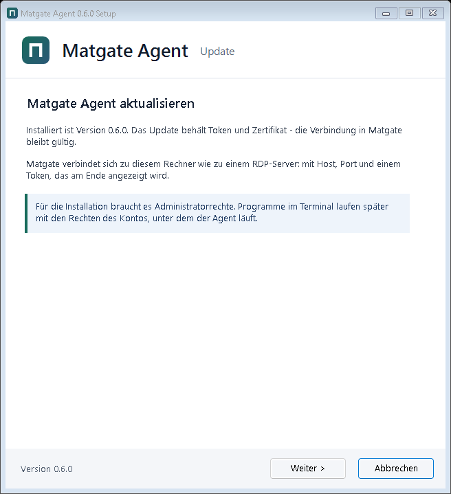
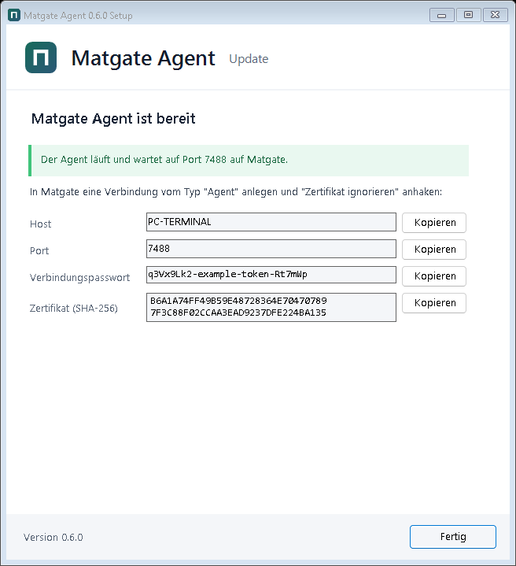
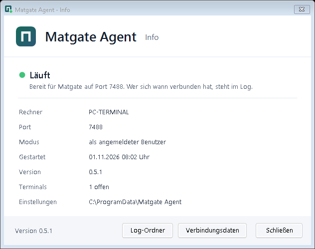
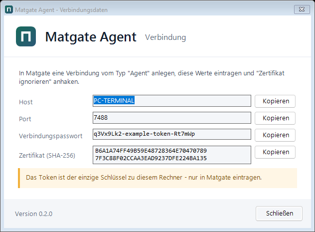
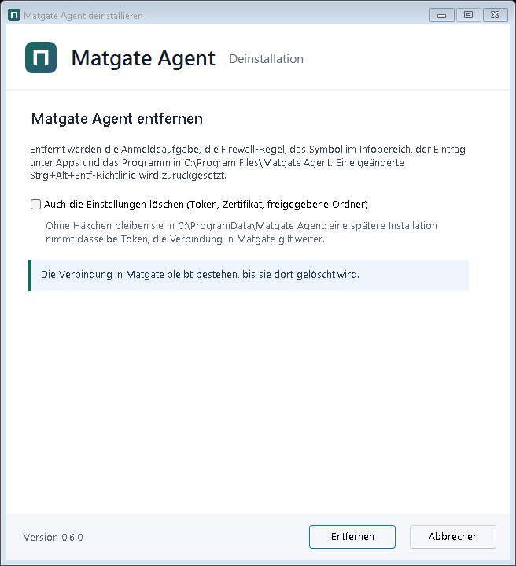

# Matgate agent

A small program on a machine that Matgate connects to - like an RDP server: host, port and a
password (the agent's token). What the machine offers is up to the agent; Matgate asks after
connecting and shows exactly that.

Plugins today:

- **Files** - the configured folders in Matgate's file manager (browse, upload, download, create,
  delete, copy between places).
- **Terminals** - programs in a terminal tab in the browser, e.g. **Claude Code** or PowerShell.
  A session keeps running when its tab closes or the browser goes away; the agent overview lists it
  with *Fortsetzen* and *Beenden*. Claude Code also offers "Letzte Unterhaltung fortsetzen"
  (`--continue`) and "Unterhaltung auswählen" (`--resume`), which survive a restart of the machine.
- **Screen** - the machine's desktop in the browser, to work on it as if sitting in front of it
  (see below).

Windows first. The file plugin runs anywhere .NET runs; terminals use Windows' pseudo console
(ConPTY) and the screen uses DXGI and Media Foundation, so both are only offered on Windows so far.

## The screen

What the monitor shows, in a tab of Matgate - like AnyDesk rather than RDP: it is the real desktop of
the signed-in user, not a session of its own, so whoever sits at the machine sees the same.

- **Picture:** DXGI desktop duplication (only changed pictures are captured), encoded as H.264 by
  Windows' own encoder in low-latency mode (baseline profile, no B-frames, one picture in, one out) and
  decoded by the browser itself (WebCodecs) onto a canvas. At most three pictures are on the way: a slow
  network gets fewer pictures, never older ones. When the screen stands still the last picture is sent
  once or twice more, sharper. Screens wider than 2560 pixels are halved.
- **Mouse pointer:** the machine's cursor shape becomes the browser's cursor, so it moves without waiting
  for a picture.
- **Keyboard:** keys travel as key positions (scan codes) and the machine's layout applies - a German
  keyboard in front of a German Windows types what is on its keys, AltGr included. Nothing stays pressed
  when the page loses the keyboard. In full screen the browser also passes on keys it otherwise keeps.
- **Sound:** what the machine plays (WASAPI loopback), as Opus where the browser can decode it, else PCM.
  Starts with the first click into the picture (browsers want one); the speaker button switches it.
- **Clipboard, both ways:** Ctrl+V with text, a picture or files on this device's clipboard puts them on
  the machine's clipboard (files as real files, as Explorer copies them) and presses Ctrl+V there - so
  files land in the folder that is open on the machine. Text and pictures copied on the machine land on
  this device's clipboard; files copied there are offered for download (a browser cannot put files on a
  clipboard).
- **Several monitors:** a choice in the bar.
- **Phone and tablet:** a tap is a click, a long press the right button, a finger that moves drags, two
  fingers scroll, pinching zooms; a key bar (Esc, Tab, Windows, Ctrl, Alt, Del, arrows) and the device's
  keyboard.
- **One viewer at a time:** a second window takes the screen over; the first says so and can take it back.

Limits: the agent has to run *as the signed-in user* (a service lives in session 0 and sees no desktop).
The lock screen and administrator prompts (UAC) are protected desktops - the page says so and continues
once they are gone. Windows that run as administrator (Task Manager, an elevated console) do not take
input from a program without administrator rights, which the agent is in user mode. Ctrl+Alt+Del cannot
be sent. It can be switched off in the setup ("Bildschirm") or with `"Screen": false`.

`matgate-agent screen-probe` captures and encodes for three seconds and prints the numbers (frames, sizes,
milliseconds per picture) - whether and how fast a machine can share its screen. The picture itself is not
kept.

## Installing it



Download `matgate-agent.exe` (the link is on the Agent connection form in Matgate, or the release
`agent-latest` on GitHub), double-click it and confirm the administrator prompt. The setup asks for:

- **Port** (default 7488) and whether other computers may reach it (one Windows firewall rule,
  "Matgate Agent").
- **How it runs:**
  - *as the signed-in user* - a task that starts it at logon, with that user's rights. Claude Code
    finds the user's login. No password needed; it runs while the user is signed in.
  - *as a Windows service under an account* (`.\name`, `DOMAIN\name` or `LocalSystem`) - runs
    without anyone signed in. The password goes straight to Windows (service configuration); the
    account gets "log on as a service". LocalSystem works but runs every program as SYSTEM.
- **Shared folders** for the file manager, which **programs** (Claude Code, PowerShell) it offers, and
  whether Matgate may show and use the **screen**.

It is a wizard like MatMon's setup: Welcome, connection and how it runs, what Matgate may see, progress,
and a last page with everything Matgate needs:



Afterwards it shows host, port, token and certificate fingerprint to copy into Matgate (connection
type *Agent*, the token as connection password, "Ignore certificate"). Running the setup again
updates the installed agent and keeps its token.

What it puts where:

| | |
|---|---|
| Program | `%ProgramFiles%\Matgate Agent\matgate-agent.exe` |
| Settings, token, certificate, `agent.log` | `%ProgramData%\Matgate Agent` (only SYSTEM, administrators and the agent's account) |
| Start | task "Matgate Agent" (user mode) or service "MatgateAgent" (service mode, restarts on failure) |
| Firewall | rule "Matgate Agent" for the port, if allowed |
| Apps & Features | "Matgate Agent" - the uninstaller |

Unattended (administrator console):

```bash
matgate-agent.exe setup --port 7488 --firewall --root "Projekte=D:\Projekte"
matgate-agent.exe setup --mode service --account ".\matgate" --password "..." --no-firewall
matgate-agent.exe setup --dry-run      # says what it would do, changes nothing
```

## The tray icon

The Matgate mark in the notification area, started at every logon (it can be switched off in the setup).
Its dot says the state: green - the agent runs; red - installed but not answering; grey - not set up.
Whether Matgate is connected right now is not shown (Matgate keeps its connection open while idle); who
connected when is in `agent.log`. Double-click opens *Info*; the menu also has *Verbindungsdaten*
(host, port, token, fingerprint to copy - for a service this asks for administrator rights), *Einstellungen
ändern* (the setup again), *Agent neu starten* and *Log-Ordner öffnen*. It only looks at the agent through a
local pipe without secrets; `matgate-agent status` shows the same in a console.

 

## Updates

Matgate brings new versions to its agents itself - the agent needs no internet access of its own. It reads the
release `agent-latest` (`matgate-agent.json`: version, SHA-256, size), fetches and checks the exe once and sends it
over the connection the agent already trusts. The agent checks size, SHA-256 and that the new exe answers
`--version` with the announced version, then a separate copy swaps the program, starts it and waits for it to
answer; if it does not within two minutes, the previous version (kept as `.bak`) is put back.

- **Automatically:** every hour, for every agent that allows it (setup: "Automatisch aktualisieren", config
  `AutoUpdate`) and has no terminal open.
- **Now:** the agent overview in Matgate shows a new version with "Jetzt aktualisieren" (for whoever may edit
  the connection).

Only the installed single-file agent updates itself; its account may write its program folder for that.

## Uninstalling it



Settings > Apps > Installed apps > **Matgate Agent** > Uninstall opens the same wizard. It asks whether to
delete the settings too (token, certificate - kept by default, so a later install keeps the same token),
then removes the service or the logon task, the tray icon and its Start menu entry, the firewall rule, the
Apps & Features entry, the settings if asked to, and the program folder - from a copy in %TEMP%, which
removes itself afterwards. Unattended: `"%ProgramFiles%\Matgate Agent\matgate-agent.exe" uninstall [--keep-config]`.

The connection in Matgate stays until it is deleted there.

## Building it

```bash
dotnet publish agent/Matgate.Agent -c Release -r win-x64 -o publish/agent
```

One self-contained file. `matgate-agent.exe run [--config path]` starts the agent by hand (a
`matgate-agent.json` next to the exe is created if missing).

## Configuration

```json
{
  "Port": 7488,
  "ListenAddress": "0.0.0.0",
  "Token": "generated on the first start",
  "Name": "",
  "CertificatePath": "matgate-agent.pfx",
  "CertificatePassword": "",
  "Roots": [ { "Name": "Home", "Path": "C:\\Users\\me" } ],
  "Terminals": [
    { "Id": "claude", "Title": "Claude Code", "Command": "cmd.exe /c claude", "Enabled": true },
    { "Id": "powershell", "Title": "PowerShell", "Command": "powershell.exe -NoLogo", "Enabled": false }
  ],
  "DetachedSessionMinutes": 0,
  "AutoUpdate": true,
  "Screen": true
}
```

- `Roots` - the only folders the file plugin can see. `..` and links cannot lead out of them.
  No roots, no file plugin.
- `Terminals` - each entry is one plugin. `Command` is the whole command line; programs run as the
  user the agent runs as, in a pseudo console with `TERM=xterm-256color`.
- `ListenAddress` - `127.0.0.1` when Matgate runs on the same machine or reaches it through a tunnel.
- `DetachedSessionMinutes` - how long a terminal without a browser keeps running (0, the default =
  until the program ends or is ended in the overview).
- `Screen` - the screen plugin (only offered while the agent runs as the signed-in user).

## Security

A terminal or the screen can do whatever the agent's user can. So:

- Prefer "as the signed-in user" or a service account without administrator rights. LocalSystem
  (or an administrator account) gives every program in a terminal full control of the machine.
- Keep the token secret; it is the only key. Change it by clearing `Token` and restarting.
- With "Ignore certificate" Matgate does not check whom it talks to; on an untrusted network give
  the agent a certificate Matgate trusts (`CertificatePath`).
- In Matgate, a user who is limited to a folder or to reading on this connection gets no terminal and
  no screen.

## Protocol

One WebSocket (`wss://host:port/matgate`, `Authorization: Bearer <token>`), opened by Matgate.
Every message is binary: a 4-byte header length, a JSON header (request, response or event) and an
optional raw payload. The format is `Matgate/Agent/AgentWire.cs`, compiled into both sides.
