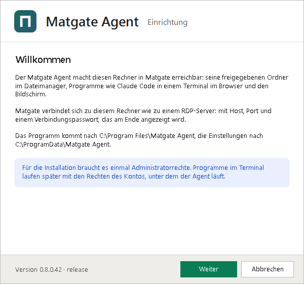
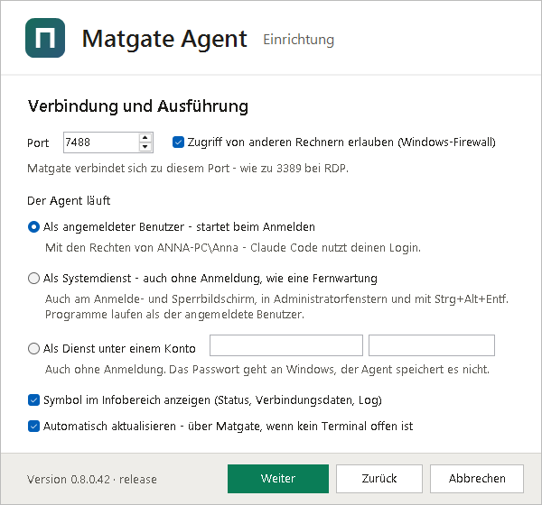
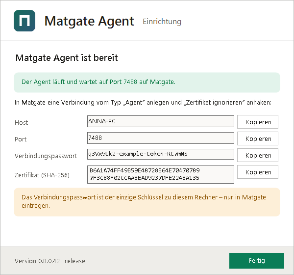
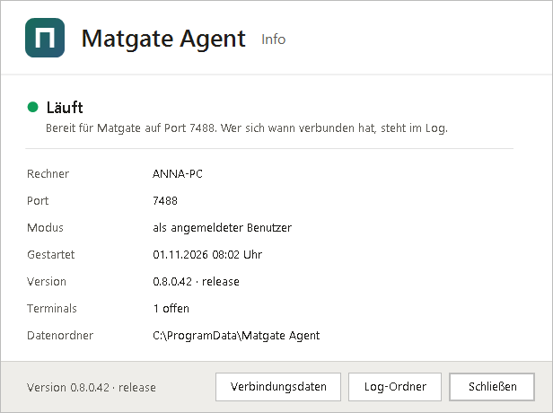
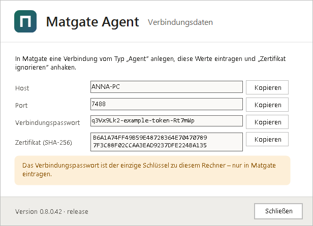
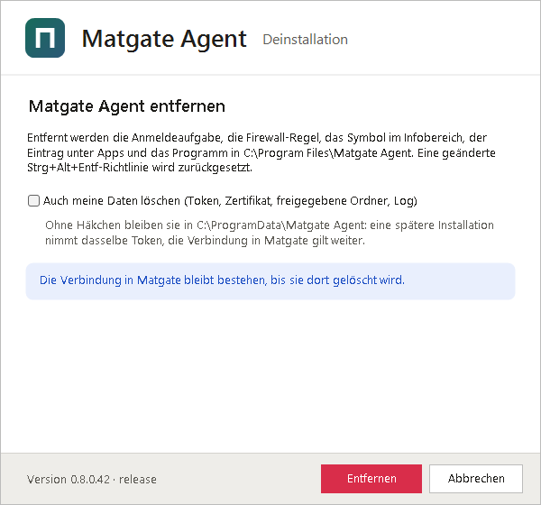

# Matgate agent

A small program on a machine that Matgate connects to - like an RDP server: host, port and a
password (the agent's token). What the machine offers is up to the agent; Matgate asks after
connecting and shows exactly that.

Plugins today:

- **Files** - the configured folders in Matgate's file manager (browse, upload, download, create,
  delete, copy between places).
- **Terminals** - programs in a terminal tab in the browser, e.g. **Claude Code** or PowerShell.
  A session keeps running when its tab closes or the browser goes away; the agent overview lists it
  with *Fortsetzen* and *Beenden*. Claude Code also offers "Letzte Unterhaltung fortsetzen"
  (`--continue`) and "Unterhaltung auswählen" (`--resume`), which survive a restart of the machine.
- **Screen** - the machine's desktop in the browser, to work on it as if sitting in front of it
  (see below).

Windows first. The file plugin runs anywhere .NET runs; terminals use Windows' pseudo console
(ConPTY) and the screen uses DXGI and Media Foundation, so both are only offered on Windows so far.

## The screen

What the monitor shows, in a tab of Matgate - like AnyDesk rather than RDP: it is the real desktop of
the signed-in user, not a session of its own, so whoever sits at the machine sees the same. In Matgate it
behaves like an RDP session: the same session toolbar (fullscreen, pointer mode, right click, keyboards,
resolution, sound, paste, Ctrl+Alt+Del, disconnect), the same status bar - the page has no bar of its own
there (it only shows one when opened on its own, outside Matgate).

- **Picture:** DXGI desktop duplication (only changed pictures are captured), encoded as H.264 in
  low-latency mode (baseline profile, no B-frames, one picture in, one out) and decoded by the browser
  itself (WebCodecs) onto a canvas. The encoder is the graphics card's (NVIDIA, AMD, Intel - through Media
  Foundation, asynchronous, so a finished picture leaves the moment it is done) and Windows' software
  encoder where there is none or it fails. Up to 60 pictures a second ("Flüssig"), 30 or 20 to save data.
  At most three pictures are on the way: a slow network gets fewer pictures, never older ones. When the
  screen stands still the last picture is sent once or twice more, sharper.
- **Microphone:** the microphone of the device in front of the browser, as a microphone of the machine
  (the toolbar's microphone button). A program cannot *be* a microphone in Windows - that takes a driver -,
  so the agent plays the voice into the playback end of a **virtual audio cable** (VB-CABLE, VoiceMeeter,
  Steam's streaming microphone): what is played there comes out of the cable's other end, which every
  program can pick as its microphone. Without such a cable the button says what is missing. Opus where
  the browser encodes it (48 kHz mono, 20 ms packets), plain samples otherwise. See `Microphone` below;
  `matgate-agent screen-probe --microphone` tells where the voice would go on this machine.
- **Game controllers:** a controller connected to the device in front of the browser is an **Xbox 360
  controller on the machine** - up to four, with rumble on the way back. That takes the
  [ViGEmBus](https://github.com/nefarius/ViGEmBus/releases) driver (the virtual gamepad bus most
  remote-play tools use); the agent speaks to it directly. Without it the page says so when a controller
  is connected. `matgate-agent screen-probe --gamepad [--plug]` tells whether the driver is there (and
  plugs a controller in for three seconds).
- **Resolution, as RDP does it:** "an Fenster anpassen" (the default) sets the machine's monitor to the
  largest mode that fits the picture area of the browser - and again whenever the window changes size; in
  full screen that is the size of this screen. A real monitor only has the modes its driver offers, so the
  picture may keep a narrow border. "wie am Rechner" leaves the monitor alone; a mode can also be picked by
  hand. The change is temporary: when the viewer leaves (or another one takes over) the monitor gets its
  own mode back, and Windows' saved setting is never touched.
- **Full screen:** Matgate's own, as for RDP - the picture takes the whole screen, the toolbar slides away
  and comes back through the handle at the top. The browser then also hands over keys it otherwise keeps for
  itself (Esc, Alt+Tab, the Windows key; holding Esc leaves full screen).
- **Statistics:** pictures per second and the round trip (agent -> browser -> acknowledgement) in the bar;
  the tooltip adds data rate, time per picture on the machine and which encoder works.
- **Mouse pointer:** the machine's cursor shape becomes the browser's cursor, so it moves without waiting
  for a picture.
- **Keyboard:** keys travel as key positions (scan codes) and the machine's layout applies - a German
  keyboard in front of a German Windows types what is on its keys, AltGr included. Nothing stays pressed
  when the page loses the keyboard. In full screen the browser also passes on keys it otherwise keeps.
- **Sound:** what the machine plays (WASAPI loopback), as Opus where the browser can decode it, else PCM.
  Starts with the first click into the picture (browsers want one); the speaker button switches it.
- **Clipboard, both ways:** Ctrl+V with text, a picture or files on this device's clipboard puts them on
  the machine's clipboard (files as real files, as Explorer copies them) and presses Ctrl+V there - so
  files land in the folder that is open on the machine. Text and pictures copied on the machine land on
  this device's clipboard; files copied there are offered for download (a browser cannot put files on a
  clipboard).
- **Several monitors:** a choice in the bar.
- **Windows:** a list of the machine's windows in the bar (what Alt+Tab offers there) - picking one brings it
  to the front, a minimised one comes back first. With "show the chosen window only" that window is the whole
  picture and stays it wherever it is moved or resized; the mouse then moves inside it. What covers the window
  on the machine covers it in the picture too - it is the window's place on the monitor that is shown.
  `matgate-agent screen-probe --windows` lists what would be offered (programs and sizes, no titles).
- **Ctrl+Alt+Del:** a button in the bar (and in a phone's key bar) - for the sign-in screen and the lock
  screen, when the agent runs as a system service.
- **Phone and tablet:** the pointer mode of the toolbar, shared with RDP sessions. *Touchpad* (a phone's
  default): the screen is one large trackpad - a finger moves the cursor on from where it is (faster when
  quicker), a tap clicks there, tap and then touch again to drag, two fingers tapped are the right button,
  two fingers moving scroll; zoomed in, the picture follows the cursor. *Direct touch* (a tablet's default):
  a tap clicks where the finger is, a long press is the right button, a moving finger drags. Pinching zooms
  in both. The keyboard buttons open the device's keyboard or the key bar - the user's own buttons
  (Account -> Key bar; by default Esc, Tab, Ctrl, Alt, Windows, Del, the arrows, Ctrl+C, Ctrl+V and
  Ctrl+Alt+Del). A letter typed while Ctrl, Alt or the Windows key is held is pressed as the key it sits on in
  the machine's keyboard layout, so it is a shortcut there.
- **One viewer at a time:** a second window takes the screen over; the first says so and can take it back.

Where it works depends on how the agent runs:

| | as the signed-in user | as a system service |
|---|---|---|
| desktop of whoever is signed in | yes | yes |
| nobody signed in: the sign-in screen | - (the agent is not running) | yes |
| lock screen, UAC prompts | no - the page says so and continues afterwards | yes |
| windows that run as administrator | shown, but they take no input | yes |
| Ctrl+Alt+Del | no | yes |

As a system service (LocalSystem, session 0, no screen of its own) the agent starts a helper as SYSTEM in
the session the monitor shows and follows it from desktop to desktop (sign-in, lock screen, UAC); when the
monitor shows another session - someone signs out, the sign-in screen gives way to a desktop - a new helper
takes over there and the picture comes back by itself. Programs in a terminal still run as the person who is
signed in, through a second helper with their token in their session: Claude Code keeps their login, as in
user mode. While nobody is signed in, programs cannot start (the screen can).

It can be switched off in the setup ("Bildschirm") or with `"Screen": false`.

`matgate-agent screen-probe` captures and encodes for three seconds and prints the numbers (frames, sizes,
milliseconds per picture) - whether and how fast a machine can share its screen. The picture itself is not
kept.

## Linux and macOS

The same agent, as the system's own service - the way it is a LocalSystem service on Windows: it starts
with the machine, before and without anyone signing in. It offers the **shared folders**, **programs in a
terminal** and the **screen** (see "The screen on Linux" and "The screen on a Mac" below - the Mac's is a
first version that no Mac has been operated with yet).

```sh
curl -fsSL -o matgate-agent https://github.com/Real-TTX/Matgate/releases/download/agent-latest/matgate-agent-linux-x64
chmod +x matgate-agent && sudo ./matgate-agent setup
```

Programs for `linux-x64`, `linux-arm64`, `osx-arm64` and `osx-x64`, one self-contained file each. The
setup prints host, port, connection password and the certificate's fingerprint for Matgate.

| | Linux | macOS |
|---|---|---|
| Program | `/opt/matgate-agent/matgate-agent` | `/usr/local/lib/matgate-agent/matgate-agent` |
| Settings (root only) | `/etc/matgate-agent/` | `/Library/Application Support/Matgate Agent/` |
| Service | systemd unit `matgate-agent.service`, as root | LaunchDaemon `com.matgate.agent`, as root |

- `sudo matgate-agent setup [--port 7488] [--root Name=/path ...] [--user name] [--no-claude] [--shell]
  [--no-auto-update] [--logo picture|--no-logo] [--dry-run]` - again any time to change something; token
  and certificate stay.
- `sudo matgate-agent uninstall [--keep-config]`, `sudo matgate-agent start|stop|restart`,
  `matgate-agent status`.
- **Who programs run as:** the service is root, a program in a terminal is not - it runs as the user of
  `--user` (by default whoever called `sudo`; `RunAs` in the settings), with that user's rights, home
  folder and shell. The agent does the change of user itself: `su` would take the terminal away from the
  program, and Ctrl+C would end everything.
- **The screen on Linux** is the machine's X display, with mouse, keyboard and the clipboard - the sign-in
  screen of the display manager as well as the desktop of whoever is signed in. The service has no display
  of its own; as root it finds the X server the monitor shows (its process, its display, the file with its
  key, the virtual terminal) and looks at it through a helper process that belongs to that display. When
  somebody signs in or out the X server changes, the helper ends with the old one and a new one shows the
  new one - the viewer stays. It needs X11's client libraries and the H.264 encoder OpenH264 from the
  distribution (Debian/Ubuntu: `apt install libx11-6 libxext6 libxfixes3 libxtst6 libxdamage1 libxrandr2` and
  `libopenh264-7` or, on the newer ones, `libopenh264-8`; Fedora: `dnf install openh264`); what is missing, the agent's log says at the start, and
  `sudo matgate-agent screen-probe` says which display it would show and whether a picture comes out.
  **Not yet:** a desktop on **Wayland** (the agent says so when the screen is opened - choose an Xorg
  session at the sign-in screen, or set `WaylandEnable=false` in GDM), the machine's sound, the browser's
  microphone and controllers. Copying from the machine brings text; pasting to it takes text, pictures and
  files. A machine without any X server (a server without a desktop) has no screen to show.
- **The screen on a Mac** (a first version): the picture of the monitor (CoreGraphics), H.264 from the Mac's
  own encoder (VideoToolbox), mouse and keys as the system's own events (Ctrl is Control, Alt is Option, the
  Windows key is Command; pasting presses Command+V), text on the clipboard in both directions. The service
  starts a helper in the session of whoever is signed in at the screen (`launchctl asuser`). **macOS asks a
  person for two permissions**, and nothing works before: System Settings > Privacy & Security > **Screen
  Recording** and > **Accessibility**, each for `/usr/local/lib/matgate-agent/matgate-agent` (the "+" there,
  then Cmd+Shift+G to type the path). The program is signed without an identity, so macOS may ask again
  after an update. `sudo matgate-agent screen-probe` says what the agent sees and what it is allowed.
  **What is known:** on GitHub's macOS 26 runner the probe captured the screen, encoded it and, started
  from a LaunchDaemon, saw the monitor of the signed-in user's session. **What is not:** a Mac operated
  through Matgate from beginning to end, the permissions as a person grants them, a Retina display, more
  than one monitor, an Intel Mac. **Not yet:** the sign-in window (nobody's session), the pointer's real
  shape (an arrow is shown), the list of windows, sound, microphone, controllers, pictures and files on the
  clipboard.
- **Terminals** are real pseudo terminals (window size, Ctrl+C, colours); a session keeps running without
  a browser, as on Windows. The default programs are Claude Code (`claude`) and, switched off, a login
  shell (`$SHELL -l`).
- **Updates** come from Matgate as on Windows - the program for the machine's own system. The new file is
  checked (size, SHA-256, its own `--version`), put in place of the running one (the one before stays as
  `matgate-agent.previous`), and the service manager starts the agent again.
- **The same program as on Windows** (`agent/Matgate.Agent`), with the same windows: started without
  arguments on a desktop it opens the setup window (it asks for an administrator's password when it
  installs - through polkit on Linux, the system's own dialog on macOS); `matgate-agent tray` is the icon in
  the notification area, started for whoever signs in. On a machine without a desktop the commands above
  do everything.
- Tested on Linux (a container of the test stack, `tests/agent-linux.js`). **macOS is built by the CI and
  has not run on a Mac yet.**

## Installing it



Download `matgate-agent.exe` (the link is on the Agent connection form in Matgate, or the release
`agent-latest` on GitHub), double-click it and confirm the administrator prompt. The setup asks for:

- **Port** (default 7488) and whether other computers may reach it (one Windows firewall rule,
  "Matgate Agent").
- **How it runs:**
  - *as the signed-in user* - a task that starts it at logon, with that user's rights. Claude Code
    finds the user's login. No password needed; it runs while the user is signed in.
  - *as a system service* - a Windows service under LocalSystem that runs without anyone signed in: the
    screen like remote maintenance (sign-in and lock screen, administrator windows, Ctrl+Alt+Del - the setup
    allows services to send it, policy `SoftwareSASGeneration`, and uninstall puts the policy back). Programs
    run as whoever is signed in (see "The screen").
  - *as a Windows service under an account* (`.\name`, `DOMAIN\name` or `LocalSystem`) - runs
    without anyone signed in. The password goes straight to Windows (service configuration); the
    account gets "log on as a service". LocalSystem works but runs every program as SYSTEM.
- **Shared folders** for the file manager, which **programs** (Claude Code, PowerShell) it offers, and
  whether Matgate may show and use the **screen**.

It is a wizard like MatMon's setup: Welcome, connection and how it runs, what Matgate may see, progress,
and a last page with everything Matgate needs:





Afterwards it shows host, port, token and certificate fingerprint to copy into Matgate (connection
type *Agent*, the token as connection password, "Ignore certificate"). Running the setup again
updates the installed agent and keeps its token.

What it puts where:

| | |
|---|---|
| Program | `%ProgramFiles%\Matgate Agent\matgate-agent.exe` |
| Settings, token, certificate, `agent.log` | `%ProgramData%\Matgate Agent` (only SYSTEM, administrators and the agent's account) |
| Start | task "Matgate Agent" (user mode) or service "Matgate Agent" (service mode, restarts on failure; an installation from 0.7 or older keeps its service "MatgateAgent" until the setup runs again) |
| Tray icon | autostart value "Matgate Agent Tray" (HKLM Run) and the Start menu entry "Matgate Agent" |
| Status | the pipe `matgate-agent-status` (state, version, port, started, open terminals - never the token) |
| Firewall | rule "Matgate Agent" for the port, if allowed |
| Apps & Features | "Matgate Agent" - the uninstaller |

Unattended (administrator console):

```bash
matgate-agent.exe setup --port 7488 --firewall --root "Projekte=D:\Projekte"
matgate-agent.exe setup --mode system                 # LocalSystem service, the screen also without sign-in
matgate-agent.exe setup --mode service --account ".\matgate" --password "..." --no-firewall
matgate-agent.exe setup --dry-run      # says what it would do, changes nothing
```

## The tray icon

The Matgate mark in the notification area, started at every logon (it can be switched off in the setup). It
follows the desktop rules of the Mat family (MatDesign, areas TRAY and AGENT): the colours are MatUi's tokens
for Matgate's accent, copied as MatDesktop's token files into `MatDesktop/` (never edited here - copy them
again with `node tools/matdesktop-copy.js <this folder> --tokens-only` in MatDesign), in the light or dark
mode of Windows.

Its dot says the state, and the second line of the menu, the tooltip (`Matgate Agent: Läuft`) and Info say it
in words: green *Läuft* - the agent answers; amber *Wartet* - it is starting or stopping (at sign-in, after
*Dienst starten*); red *Gestoppt* - installed but not answering; grey *Nicht eingerichtet*. Whether Matgate is
connected right now is not shown (Matgate keeps its connection open while idle); who connected when is in
`agent.log`.

A left click opens *Info*, the right click the menu:

| | |
|---|---|
| Matgate Agent 0.8.0.17 | the version (disabled) |
| Läuft | the state (disabled) |
| **Matgate Agent öffnen** | Info - the agent has no page of its own |
| Verbindungsdaten … | host, port, password, fingerprint to copy (for a service this asks for administrator rights) |
| Info … · Einrichten … · Log-Ordner öffnen | Einrichten is the setup again (administrator rights) |
| Dienst starten … / beenden … / neu starten … | with the shield, whichever applies now; *Agent …* in user mode |
| Beenden | ends the icon, never the agent |

There is no uninstall in the menu (Settings > Apps does that). The icon only looks at the agent through the
local pipe `matgate-agent-status`, which carries no secret; `matgate-agent status` shows the same in a
console. Stopping or restarting the agent leaves every icon running.

 

`matgate-agent snapshot <folder>` draws every window - the setup steps, the update, the uninstall, Info,
the connection details, the tray menu and the icon in its four states - into PNG files, light and dark, from
sample data (the computer ANNA-PC, the user Anna, a sample password): nothing of the machine it runs on, so
the pictures may be published. The ones in `docs/images` are made that way.

## Updates

Matgate brings new versions to its agents itself - the agent needs no internet access of its own. It reads the
release `agent-latest` (`matgate-agent.json`: version, SHA-256, size), fetches and checks the exe once and sends it
over the connection the agent already trusts. The agent checks size, SHA-256 and that the new exe answers
`--version` with the announced version, then a separate copy swaps the program, starts it and waits for it to
answer; if it does not within two minutes, the previous version (kept as `.bak`) is put back. The swap moves
the old program aside rather than overwriting it - the tray icon of every signed-in user runs from the same
file, and a running program can be renamed but not overwritten; the icons then restart from the new one.

- **Automatically:** every hour, for every agent that allows it (setup: "Automatisch aktualisieren", config
  `AutoUpdate`) and has no terminal open.
- **Now:** the agent overview in Matgate shows a new version with "Jetzt aktualisieren" (for whoever may edit
  the connection).

Only the installed single-file agent updates itself; its account may write its program folder for that.

## Uninstalling it



Settings > Apps > Installed apps > **Matgate Agent** > Uninstall opens the same wizard. It asks whether to
delete the settings too (token, certificate - kept by default, so a later install keeps the same token),
then removes the service or the logon task, the tray icon and its Start menu entry, the firewall rule, the
Apps & Features entry, the settings if asked to, and the program folder - from a copy in %TEMP%, which
removes itself afterwards. Unattended: `"%ProgramFiles%\Matgate Agent\matgate-agent.exe" uninstall [--keep-config]`.

The connection in Matgate stays until it is deleted there.

## Building it

```bash
dotnet publish agent/Matgate.Agent -c Release -r win-x64 -o publish/agent     # or linux-x64, linux-arm64, osx-arm64, osx-x64
```

One project for every system. Its windows are **Avalonia** in the look of **MatDesktop** (`MatDesktop/`,
the desktop toolkit of MatDesign - a copy, never edited here: change it in MatDesign and copy it again with
`node tools/matdesktop-copy.js <this folder>`): `Ui/AgentSetup.cs` (the setup window), `Ui/AgentTray.cs` (the
icon, Info, the connection details), `Ui/Snapshot.cs` (the pictures). What talks to Matgate is the same
everywhere (the files in the project's folder); what belongs to a system is compiled only for it - Windows:
`ConPty`, `PtyLauncher`, `SessionHost`, `SessionNative`, `UpdatePlugin`, `Screen/`, `Setup/Installer`;
Linux and macOS: `Unix/`. `Setup/AgentInstall.cs` is the one door to either installer.

One self-contained file. `matgate-agent.exe run [--config path]` starts the agent by hand (a
`matgate-agent.json` next to the exe is created if missing).

## The tunnel

With **Tunnel** switched on (setup, or `"Tunnel": true` in the configuration), Matgate reaches other
machines in this machine's network through the agent - an RDP server, a share, a database - as if it stood here.
In Matgate a connection is set to *Connect via: Tunnel through <agent>*. `TunnelAllow` limits where it may lead
(`["10.0.0.0/8", "nas.local"]`; empty: anywhere this machine reaches). Off by default: it opens this network to
whoever may use the agent's connection in Matgate.

**Without an open port:** with `MatgateUrl` set (`"https://matgate.example.com"`, also in the setup) the agent
connects to Matgate itself and keeps that connection, trying again when it breaks. Matgate then uses it for
everything - files, terminals, screen, tunnel - also when it cannot reach the agent's host.

## Configuration

```json
{
  "Port": 7488,
  "ListenAddress": "0.0.0.0",
  "Token": "generated on the first start",
  "Name": "",
  "CertificatePath": "matgate-agent.pfx",
  "CertificatePassword": "",
  "Roots": [ { "Name": "Home", "Path": "C:\\Users\\me" } ],
  "Terminals": [
    { "Id": "claude", "Title": "Claude Code", "Command": "cmd.exe /c claude", "Enabled": true },
    { "Id": "powershell", "Title": "PowerShell", "Command": "powershell.exe -NoLogo", "Enabled": false }
  ],
  "DetachedSessionMinutes": 0,
  "AutoUpdate": true,
  "Screen": true,
  "Logo": "",
  "Microphone": "",
  "Gamepads": true
}
```

- `Roots` - the only folders the file plugin can see. `..` and links cannot lead out of them.
  No roots, no file plugin.
- `Terminals` - each entry is one plugin. `Command` is the whole command line; programs run as the
  user the agent runs as, in a pseudo console with `TERM=xterm-256color`.
- `ListenAddress` - `127.0.0.1` when Matgate runs on the same machine or reaches it through a tunnel.
- `DetachedSessionMinutes` - how long a terminal without a browser keeps running (0, the default =
  until the program ends or is ended in the overview).
- `Screen` - the screen plugin (offered in user mode and as a system service, not under another service
  account).
- `Logo` - the picture on this machine's start page in Matgate: a path to a PNG, JPG, WebP, GIF or SVG of
  at most 1 MB (relative paths start at the folder of this file). The setup's page "Was Matgate sehen
  darf" picks one and keeps a copy; `setup --logo picture` and `--no-logo` do the same. Without the
  setting a file called `logo.png` (or `.jpg`, `.webp`, `.gif`, `.svg`) next to this file is taken -
  dropped there by hand it shows at once, without a restart.
- `Microphone` - where a viewer's microphone is played: empty = into a virtual audio cable if the
  machine has one; a part of a playback device's name = into that device; `speakers` = on the machine's
  loudspeakers (an intercom rather than a microphone); `off` = nowhere.
- `Gamepads` - `false` keeps a viewer's controllers out, driver or not.

## Security

A terminal or the screen can do whatever the agent's user can. So:

- Prefer "as the signed-in user" or a service account without administrator rights for files and
  programs. As a *system service* the screen has full control of the machine, sign-in screen included -
  that is its point, as with any remote maintenance tool; programs still run as the signed-in person, and
  files are read and written as SYSTEM inside the shared folders. A service under an administrator account
  gives every program in a terminal full control.
- Keep the token secret; it is the only key. Change it by clearing `Token` and restarting.
- With "Ignore certificate" Matgate does not check whom it talks to; on an untrusted network give
  the agent a certificate Matgate trusts (`CertificatePath`).
- In Matgate, a user who is limited to a folder or to reading on this connection gets no terminal and
  no screen.

## Protocol

One WebSocket (`wss://host:port/matgate`, `Authorization: Bearer <token>`), opened by Matgate.
Every message is binary: a 4-byte header length, a JSON header (request, response or event) and an
optional raw payload. The format is `Matgate/Agent/AgentWire.cs`, compiled into both sides.
